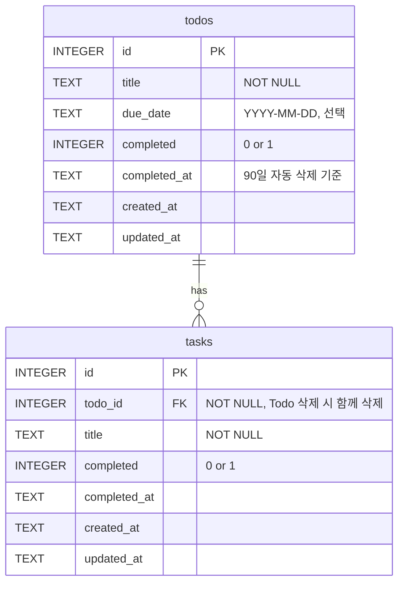

# PRD - Task Hive (Todo 앱)

## [무엇]
내 컴퓨터에서 도는 Todo(할 일) 앱. 큰 할 일(Todo) 아래에 잘게 쪼갠 하위 태스크(Task)를 두고 하나씩 체크한다.

## [기본 기능(CRUD)]
- 할 일 추가 / 목록 보기 / 완료 표시 / 삭제
- 태스크도 추가 / 보기 / 완료 표시 / 삭제

## [저장]
- 데이터는 내 컴퓨터의 무료 DB(SQLite, `data/todo.db`)에 저장 - 껐다 켜도 남는다.
- 화면은 백엔드 API에만 요청하고, DB 접근 코드는 백엔드에만 둔다.

## [내가 넣고 싶은 기능]

### 1. 하위 태스크
- Todo는 태스크 없이 단독으로 등록할 수 있다.
- 태스크는 단독으로 존재할 수 없고 반드시 하나의 Todo에 속한다.
- Todo를 완료하려고 할 때 아직 안 끝난 태스크가 있으면 확인창을 띄운다.
  - "완료하지 않은 태스크가 N개 있습니다. 그래도 완료하시겠습니까?"
  - 확인하면 Todo와 남은 태스크를 모두 완료 처리한다.
- 완료된 Todo의 태스크를 다시 미완료로 바꾸면 Todo도 미완료로 돌아간다.

### 2. 등록 화면 (아래쪽)
- 할 일 입력은 화면 아래쪽에 둔다.
- "태스크로 등록" 체크박스가 있다.
  - 체크 안 함 → Todo로 등록 (마감일 선택 가능)
  - 체크 함 → 어느 Todo에 넣을지 라디오 버튼으로 선택
- 라디오 목록에는 완료하지 않은 Todo만 나온다.
- 완료된 Todo에는 태스크를 추가할 수 없다(백엔드에서도 거절한다).

### 3. 검색 (위쪽)
- 화면 위쪽에 검색창을 둔다. Todo 제목과 태스크 제목에서 찾는다.

### 4. 마감일 / 오늘 할 일만 보기
- Todo에 마감일을 붙일 수 있다(선택).
- "오늘 할 일만 보기"를 켜면 마감일이 오늘인 Todo만 보인다.

### 5. 완료 항목 90일 후 자동 삭제
- 완료한 Todo는 완료 시점으로부터 90일이 지나면 자동 삭제한다(태스크도 함께).
- 완료한 Todo 오른쪽에 "완료 후 90일 뒤 자동 삭제 (YYYY-MM-DD)" 문구를 보여 준다.

### 6. 삭제 확인
- 태스크가 있는 Todo를 지울 때만 확인창을 띄운다.
  - "하위 태스크 N개도 함께 삭제됩니다. 삭제하시겠습니까?"
- 태스크가 없는 Todo, 태스크 하나는 바로 삭제한다.

## [규칙]
- 무료 도구만. 비밀값은 `.env`로.
- `.env`, `data/*.db`는 Git에 올리지 않는다.
- DB에 넣는 값은 파라미터화 쿼리로만 처리한다.
- 화면에서 막는 규칙(완료된 Todo에 태스크 추가 금지 등)은 백엔드에서도 다시 검사한다.

## [진행 순서]
- 길 A: 로컬 SQLite로 구현
- 길 B: 저장소를 Supabase로 전환 + Supabase Auth 로그인 + RLS(자기 할 일만 접근)
- 길 C(선택): 백엔드를 Render 등에 실제 배포

## [DB 구조]
상세 정의는 [db/schema.sql](db/schema.sql).

- todos 1 : N tasks (일대다). 태스크는 `todo_id`가 NOT NULL이라 Todo 없이 존재할 수 없다.
- 태스크 아래에 또 태스크는 없다(한 단계만).
