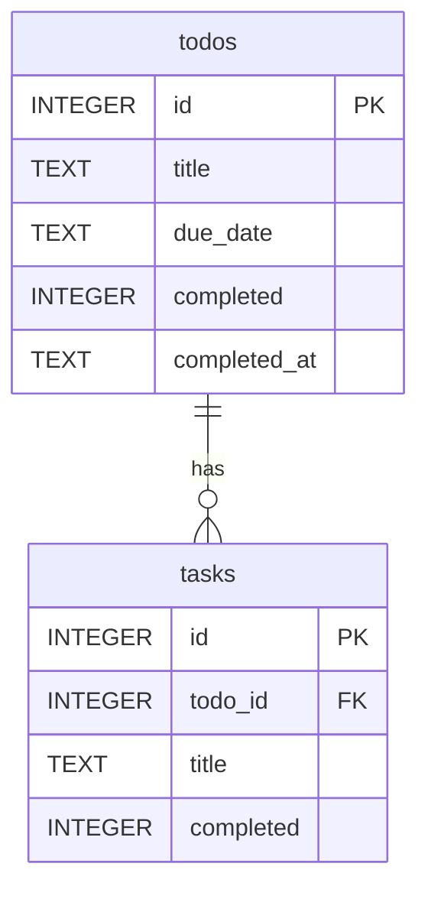

# TODO

큰 할 일(Todo) 아래에 하위 태스크(Task)를 두고 하나씩 체크하는 Todo 앱.
데이터는 내 컴퓨터의 SQLite 파일에 저장되어 껐다 켜도 남는다.

- **데모:** https://eple-lab.github.io/todo/ (서버 없이 브라우저에서만 동작, 새로고침하면 초기화)
- **기획서:** [docs/PRD.md](docs/PRD.md)
- **문서 전체:** [docs/](docs/README.md)

## 화면


- 위쪽: 검색창(할 일·태스크 제목), "오늘 할 일만" 보기
- 가운데: 할 일과 하위 태스크. 진행률(2/4), 마감일, 완료한 할 일의 자동 삭제 날짜가 오른쪽에 표시된다. 오늘 마감인 할 일은 노란 배경
- 아래쪽: 할 일 등록(마감일 기본값 오늘). "태스크로 등록"을 체크하면 넣을 할 일을 고른다

## 주요 기능

- 할 일 추가·완료·삭제, 하위 태스크 추가·완료·삭제
- 안 끝난 태스크가 있는 할 일을 완료하거나, 태스크가 있는 할 일을 지울 때 확인
- 할 일·태스크 제목 검색, 오늘 할 일만 보기
- 마감일 필수(기본값 오늘, 지난 날짜 금지), 중복 제목 금지
- 완료 후 90일 지나면 자동 삭제

규칙 전체는 [docs/business-rules.md](docs/business-rules.md).

## 실행 방법

필요한 것: Node.js 24 이상 (SQLite가 Node에 내장되어 있어 따로 설치할 DB가 없다)

```bash
npm install
npm start
```

브라우저에서 http://localhost:3000 을 연다.

- DB 파일은 처음 실행할 때 `data/todo.db`에 자동으로 만들어진다. 코드를 받은 사람은 빈 DB로 시작한다.
- 포트나 DB 위치를 바꾸려면 `.env.example`을 `.env`로 복사해 고친다.
- 백업, 문제 해결은 [docs/operations.md](docs/operations.md).

## 폴더 구조

```
server.js           백엔드: API 창구와 규칙 검사
db.js               DB 접근 코드는 전부 여기에만 (길 B에서 이 파일을 Supabase용으로 교체)
db/schema.sql       표를 만드는 SQL
public/             화면(프론트): 백엔드 API에만 요청한다
public/demo-api.js  GitHub Pages 데모용 가짜 백엔드
docs/               기획서와 문서, 화면 캡처
.github/workflows/  push하면 public/을 GitHub Pages에 올리는 설정
data/todo.db        실제 데이터 (자동 생성, Git 제외)
```

자세한 구조는 [docs/architecture.md](docs/architecture.md).

## DB 구조

표 2개, **todos 1 : N tasks**. 태스크는 반드시 할 일 하나에 속하고, 할 일을 지우면 함께 지워진다.



열 설명, 제약조건, 색인, 화면 기능별 SQL은 [docs/database.md](docs/database.md). API는 [docs/api.md](docs/api.md).

## 문서

| 문서 | 내용 |
|---|---|
| [PRD](docs/PRD.md) | 만들 기능과 조건 |
| [규칙](docs/business-rules.md) | 앱이 지키는 규칙, 어디서 막는지 |
| [구조](docs/architecture.md) | 파일별 역할, 요청 흐름 |
| [데이터베이스](docs/database.md) | 표·열·제약·색인·SQL |
| [API](docs/api.md) | 주소, 요청·응답 예시 |
| [보안](docs/security.md) | SQL 주입, XSS, 비밀값 |
| [운영](docs/operations.md) | 실행, 백업과 복구, 문제 해결 |
| [테스트](docs/testing.md) | 과제 확인 체크리스트, 테스트 기록 |
| [배포](docs/deployment.md) | GitHub Pages 데모, 배포 준비물 |
| [결정 기록](docs/decisions.md) | 왜 이렇게 만들었는지 |
| [로드맵](docs/roadmap.md) | 진행 기록, 길 B 계획 |
| [회고](docs/retrospective.md) | 강의 회고 노트 |

## 진행 기록

- [x] 길 A: 로컬 SQLite로 구현
- [ ] 길 B: Supabase로 저장소 전환 + 로그인 + RLS
- [ ] 길 C(선택): Render 등에 배포

자세한 내용은 [docs/roadmap.md](docs/roadmap.md).
