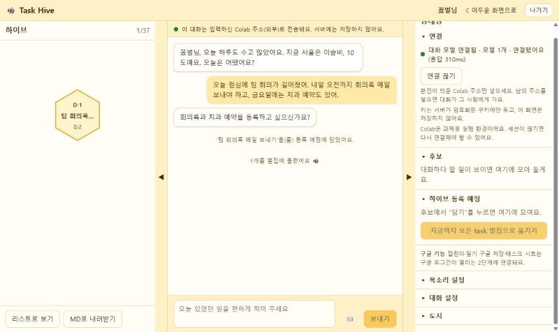
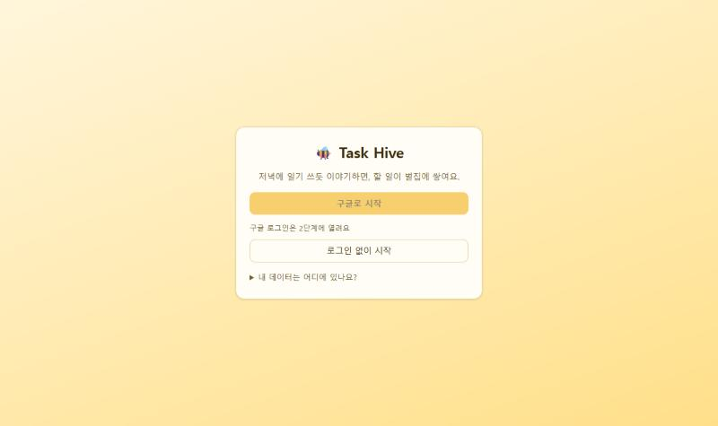
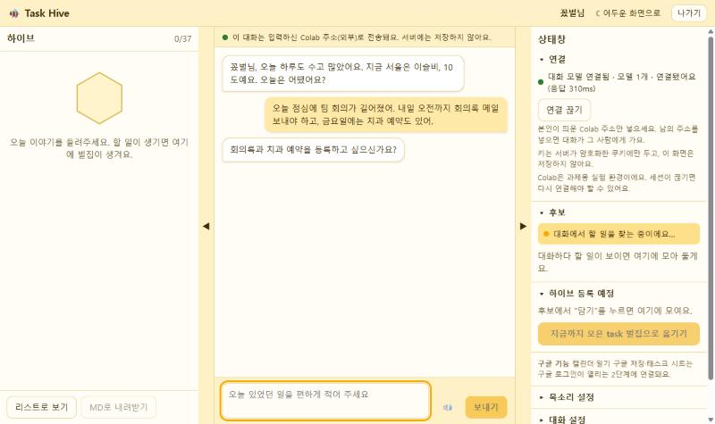
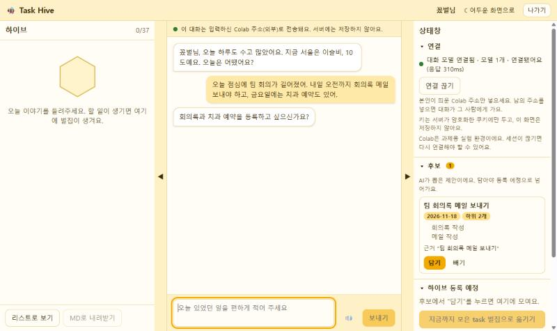
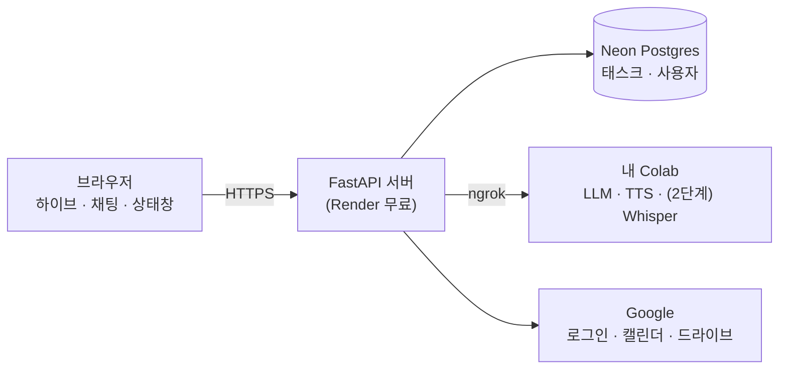

# 🐝 Task Hive

> 저녁에 일기 쓰듯 AI와 이야기하면, 할 일이 벌집에 쌓인다.

**지금 상태: 1단계 MVP가 로컬에서 동작한다. 모델 검증은 진행 중이다.** (2026-11-17 기준)

- 손님 모드로 대화 → AI가 할 일 후보를 뽑음 → 담기 → 벌집 등록까지 실제 서버와 로컬 LLM(Ollama llama3.2)으로 끝까지 확인했다.
- 백엔드 테스트 214개, 화면 테스트 37개가 통과한다.
- 첫 모델 측정(llama3.2)은 성공 기준을 **넘지 못했다.** 이유와 실패 사례는 [아래](#검증-결과)와 [PoC-01](docs/poc/poc-01-llm-summary.md)에 있다.
- 구글 로그인·캘린더·일기 저장, Colab TTS는 2단계다. 배포 파일은 있지만 아직 배포하지 않았다.

## Task Hive는 무엇인가

할 일 앱은 할 일을 **이미 알고 있는 사람**이 적는 도구다. Task Hive는 그 앞 단계를 맡는다. 하루를 돌아보며 AI와 편하게 이야기하면, AI가 대화 속에서 할 일을 찾아 "이건 담아 둘까요?"라고 묻는다. 담은 할 일은 육각형 벌집 한 칸이 되고, 끝낼수록 꿀이 찬다.

- **대화로 할 일 모으기**: 내 Colab에 올린 LLM과 글로 이야기한다. AI는 목소리로도 답한다(켜고 끌 수 있다).
- **벌집에 쌓기**: 모은 할 일을 "벌집으로 옮기기"로 등록하면 꿀통을 든 벌이 벌집으로 날아간다.
- **조심스러운 확인**: 등록한 할 일 이야기가 나오면 진행 상황을 부드럽게 묻고, "그건 한 것 같아"라고 하면 체크해 준다.
- **구글 시트로 내보내기** (켜고 끌 수 있음): 벌집의 할 일을 내 구글 시트에 사본으로 남긴다.
- **구글 캘린더 가져오기** (켜고 끌 수 있음): 내가 소유한 캘린더의 지난 7일과 앞으로 30일 일정을 읽어 할 일 후보로 보여 준다.
- **오늘의 일기** (켜고 끌 수 있음): 대화를 요약해 내 구글 드라이브의 시트나 Docs에 적는다.
- **로그인 없이도**: 이름만 적고 쓸 수 있다. 내려받으면 바로, 아니면 24시간 뒤 지워진다.

## 화면



| 영역 | 내용 | 접기 |
|---|---|---|
| 왼쪽: 하이브 | 벌집, 리스트로 보기, MD로 내려받기 | 가능 (◀) |
| 가운데: 채팅 | 외부 전송 안내, 대화, 입력창, 말하기 토글 | 항상 보임 |
| 오른쪽: 상태창 | 연결, 후보, 하이브 등록 예정, 목소리·대화 설정, 도시 | 가능 (▶) |

구글 기능(캘린더, 일기 저장, 구글시트)은 2단계라 지금은 상태창에 안내 문구만 있다. 자세한 화면 구조: [docs/04-screens.md](docs/04-screens.md)

### 시연 화면

로컬에서 실제 서버 + 로컬 LLM(Ollama llama3.2)으로 찍었다. 대화는 지어낸 문장이다.

| 1. 시작 (손님 모드) | 2. 대화, 할 일 찾는 중 |
|---|---|
|  |  |
| **3. 후보: 담기 / 빼기** | **4. 벌집으로 옮긴 뒤** |
|  |  |

3번에서 모델은 "회의록 메일 보내기"(내일)만 뽑고 "금요일 치과 예약"은 놓쳤다. 작은 모델이 할 일 두 개 중 하나를 놓치는 것은 측정에서도 반복된 실패다(PoC-01 8장 ④). 그래서 후보는 사용자가 골라 담아야 등록된다.

## 구조



| 영역 | 사용 |
|---|---|
| 서버 | Python, FastAPI |
| 화면 | React + Vite + TypeScript, 벌집은 SVG |
| DB | 지금은 메모리 저장소(서버를 끄면 사라짐). Neon Postgres는 2단계 |
| 배포 | Render 무료, Docker 다단계 빌드 (`Dockerfile`, `render.yaml`. 아직 배포 전) |
| LLM | OpenAI 호환 API면 된다: Colab + vLLM + ngrok, 또는 개발 중에는 로컬 Ollama |
| 말하기 | 지금은 브라우저 내장 음성. Colab TTS는 자리만 (2단계) |
| 받아쓰기 | Colab Whisper (2단계) |
| 로그인 | 지금은 손님 모드. 구글 로그인은 2단계 |

자세한 구조: [docs/03-architecture.md](docs/03-architecture.md)

## 사용하는 AI 모델

메인 퀘스트 조건(배운 모델을 1개 이상 직접 실행)에 맞춰 직접 돌린다. 어떤 모델을 쓸지는 같은 자료 20건으로 비교한 뒤 정한다.

| 역할 | 하는 일 | 후보 |
|---|---|---|
| 텍스트 생성 (LLM) | 대화, 할 일 추출, 일기 요약 | llama3.2 3B (로컬 Ollama, **측정함**), Qwen 4B AWQ (Colab, 측정 전) |
| 음성 생성 (TTS) | 답을 목소리로 읽기 | MeloTTS-Korean, Supertonic 2, XTTS-v2 |
| 음성 인식 (STT) | 말로 입력하기 (2단계) | Whisper |

실험 계획: [docs/poc/](docs/poc/README.md)

## 검증 결과

가상 저녁 대화 20건(할 일 19개)으로 잰다. 정답은 모델을 돌리기 전에 고정했다. 판정 기준은 [D-33](docs/02-decisions.md): 재현율 80% 이상, 지어낸 할 일 3개 이하, 할 일 없는 대화 3건 중 2건 통과, 손 입력보다 빠름.

| 후보 | 재현율 | 지어낸 할 일 | 없는 대화 | 완료 신호 | 첫 글자 시간 | 판정 |
|---|---|---|---|---|---|---|
| 손 입력 (`todo` 앱, 기준선) | **1.00** | 3 (일정을 할 일로) | 3 / 3 | - | - | 20건 23분, 읽는 시간 포함 (한 건당 약 69초) |
| llama3.2 3B (로컬 Ollama, CPU) | 0.63 | 8 | 0 / 3 | 2 / 10 | 약 24초 | **못 넘음** |
| Qwen 4B AWQ (Colab GPU) | 측정 전 | | | | | |

- 손 입력은 할 일을 하나도 놓치지 않았지만 20건에 23분이 걸렸다. llama3.2는 이 PC(CPU)에서 모델 응답만 한 건당 약 61초라 시간에서도 나아졌다고 말할 수 없다. **지금 후보로는 개선 효과를 보이지 못했다.**
- llama3.2가 잘한 것: 애매한 날짜("월말까지"), 하위 태스크 구조, JSON 형식(오류 0건).
- llama3.2가 못한 것: **할 일이 아닌 것을 거르지 못했다.** 지어낸 8개 중 7개가 지난 일·취소된 일·남의 일을 할 일로 만든 것이다. 할 일 두 개를 하나로 합치거나, 지시문의 예시 문구("숙소 예약, 기차표 예매")를 관계없는 대화에 복사하기도 했다.
- 자세한 결과와 실패 사례: [docs/poc/poc-01-llm-summary.md](docs/poc/poc-01-llm-summary.md), 결과 파일 [eval/results/](eval/results/)

## 내 데이터는 어디에 있나

| 데이터 | 있는 곳 | 서버에 남나 |
|---|---|---|
| 대화 내용 | 브라우저, 전송 중에만 서버와 내 Colab | **남지 않는다** |
| 일기 | 내 구글 드라이브 (손님은 내려받은 파일) | **남지 않는다** |
| 할 일 | Neon DB (암호화 저장 제안), 사본은 내 구글 시트 | 남는다 |
| 캘린더 일정 | 고른 것만 할 일로 | 고르지 않은 것은 남지 않는다 |
| 구글 이메일·이름 | 받지 않는다 | **남지 않는다** |
| 목소리 | 저장하지 않는다 | **남지 않는다** |

- 채팅창 위에 "이 대화는 외부(내 Colab)로 전송된다"는 안내를 항상 보여 준다.
- 구글 권한은 필요한 것만, 사용자가 기능 연결을 누를 때 받는다. 구글 토큰은 약 1시간짜리만 쓰고 오래 가는 토큰은 받지 않는다.
- 자세한 내용: [docs/05-security.md](docs/05-security.md)

## 문서

| 문서 | 내용 |
|---|---|
| [docs/README.md](docs/README.md) | 문서 목차, 용어, 표기 규칙 |
| [00 문제 정의서](docs/00-problem-definition.md) | 과제 제출용 문제 정의 |
| [01 사용자 요구사항](docs/01-requirements.md) | 무엇을 만드는가 |
| [02 결정 기록](docs/02-decisions.md) | 왜 이렇게 정했는가 |
| [03 아키텍처](docs/03-architecture.md) | 구성 요소, 폴더 구조, 데이터 이동, 로컬 실행 |
| [04 화면 구조](docs/04-screens.md) | 3단 화면, 로그인 단계, 벌집, 상태창 |
| [05 보안과 DevSecOps](docs/05-security.md) | 개인정보, 토큰, 위협과 대응, 파이프라인 |
| [06 로드맵](docs/06-roadmap.md) | 단계별 범위와 완료 기준 |
| [07 열린 질문](docs/07-open-questions.md) | 아직 정하지 않은 것 |
| [08 성능 검토 화면](docs/08-performance-review.md) | 운영 지표와 PoC 검증 화면 |
| [09 확인 기록](docs/09-verification.md) | 공식 문서로 확인한 사실과 출처 |
| [10 프론트 구성](docs/10-frontend-architecture.md) | React + Vite + TypeScript 구성 |
| [11 API 계약](docs/11-api-contract.md) | 백엔드와 화면의 요청·응답 약속 |
| [이어받기 노트](docs/HANDOFF.md) | 다음 작업자가 먼저 읽는 문서 |
| [확인사항](docs/checks/README.md) | 자세히 확인한 주제별 문서 (구글 로그인 7일 만료, Docs 이미지 등) |
| [PoC](docs/poc/README.md) | 직접 실행해 확인할 실험 계획과 기록 |

## 로드맵

| 단계 | 내용 | 상태 |
|---|---|---|
| 0 | 기획: 요구사항, 아키텍처, 문제 정의서 | 끝 |
| 1 | 대화로 벌집 쌓기 (손님 모드, 대화, 추출, 벌집, TTS) | 로컬 동작, 모델 검증 중 (TTS는 브라우저 음성) |
| 2 | 구글 로그인, 캘린더, 일기, 말로 입력 | 예정 |
| 3 | 배포, 성능 화면, 보안 파이프라인 | 배포 파일만 있음 |
| 4 | 3D 벌집, 칸 옮기기, 검색 | 예정 |
| 5 | 구독·결제 | 예정 |

자세한 내용: [docs/06-roadmap.md](docs/06-roadmap.md)

## 실행 방법

Windows 기준이다(Git Bash). 필요한 것: Python 3.14, Node 24.

### 1. 설치

```bash
python -m venv .venv
.venv/Scripts/python.exe -m pip install -r requirements-dev.txt
cd frontend && npm ci && npm run build && cd ..
```

### 2. 서버 켜기

```bash
APP_ENV=development UPSTREAM_ALLOW_LOCALHOST=true .venv/Scripts/python.exe -m uvicorn app.main:app --port 8000
```

- `http://localhost:8000`을 연다. 서버가 빌드한 화면(`frontend/dist`)도 함께 내준다.
- 개발 환경에서는 비밀값이 없으면 실행할 때마다 임시값을 만든다. `.env` 파일은 없어도 된다. 다른 설정은 위처럼 명령 앞에 환경변수로 붙인다(이름과 뜻은 `.env.example`). uvicorn의 `--env-file`은 `python-dotenv`가 필요한데 `requirements.txt`에 없어서 지금은 쓰지 않는다.
- `UPSTREAM_ALLOW_LOCALHOST=true`는 개발에서만 `http://localhost` LLM 주소를 받게 하는 설정이다. 운영에서는 ngrok `https` 주소만 받는다.
- 화면을 고치면서 볼 때: `cd frontend && npm run dev` (Vite가 `/api`를 8000으로 넘긴다). 서버 없이 화면만: `npm run dev:mock`.

### 3. LLM 연결

이름을 적고 "로그인 없이 시작" → 오른쪽 상태창 "연결"에 주소와 접속 키를 넣는다.

| LLM | 주소 | 접속 키 |
|---|---|---|
| 로컬 Ollama (개발용) | `http://localhost:11434` (`ollama pull llama3.2` 필요) | 아무 값 |
| 내 Colab | 노트북 마지막 셀이 보여 주는 `https://….ngrok-free.app` | 노트북이 보여 준 키 |

Colab 노트북(`colab/task_hive_server.ipynb`) 사용법: [colab/README.md](colab/README.md). **이 노트북은 아직 실제로 실행해 확인하지 못했다.**

### 4. 테스트

```bash
.venv/Scripts/python.exe -m pytest -q
```

```bash
cd frontend && npm run typecheck && npm test
```

### 5. 모델 측정 (PoC-01)

```bash
.venv/Scripts/python.exe eval/run_eval.py --base-url http://localhost:11434 --model llama3.2 --label llama32-ollama --timeout 300 --completions eval/samples/completions.jsonl
```

- Colab이면 `--base-url`에 ngrok 주소, 접속 키는 환경변수 `TASK_HIVE_EVAL_API_KEY`로 넘긴다.
- 모델 없이 채점 로직만 볼 때: `--dry-run`.
- 결과는 `eval/results/`에 `.md`와 `.json`으로 남는다. 자료 설명: [eval/samples/README.md](eval/samples/README.md)

### 6. 배포 (아직 안 함)

`render.yaml`(Render Blueprint)과 `Dockerfile`(화면 빌드 → Python 서버)이 있다. 비밀값 4개(`PUBLIC_BASE_URL`, `SESSION_SECRET`, `DATA_ENC_KEY`, `SUB_HASH_KEY`)는 Render 화면에서 넣는다. 이 PC에 Docker가 없어 Docker 빌드는 확인하지 못했다. → [docs/09-verification.md](docs/09-verification.md) 2.12

### Colab을 쓸 때 알아 둘 것

- Colab은 **과제용 실험 환경**으로 쓴다. LLM이 한국어 대화를 요약하고 할 일을 뽑을 수 있는지 확인하는 것이 목적이다.
- Colab 무료는 자원이 보장되지 않고 세션이 끊길 수 있다. 계속 켜 두는 서비스의 기반으로 쓰지 않는다.
- 본인이 띄운 Colab 주소만 넣는다. 남의 주소를 넣으면 대화가 그 사람에게 간다.

## 과제 정보

AIFFEL 「AI 이해하고 사용하기」 메인 퀘스트 2 "내 도메인에서 AI로 개선 지점 찾아서 PoC 만들기"의 결과물이다.

| 제출물 | 위치 | 상태 |
|---|---|---|
| 문제 정의서 | [docs/00-problem-definition.md](docs/00-problem-definition.md) | 작성함 (검증 전) |
| PoC 코드·노트북 (모델 선정 근거 포함) | `app/`, `frontend/`, `colab/`, `eval/`, `docs/poc/` | 코드 동작함. Colab 노트북은 실행 확인 전 |
| 개선 효과 검증 (기존 방식 비교, 실패 사례) | `eval/`, `docs/poc/` | 기준선·llama3.2 측정, 실패 사례 정리함. Qwen 남음 |
| README (실행 방법, 시연 자료) | 이 파일 | 실행 방법, 시연 화면, 검증 결과 요약 |

## 배우며 만든 것에서 가져온 것

| 가져온 것 | 프로젝트 |
|---|---|
| 할 일·하위 태스크 규칙, 화면·서버·DB 세 곳 검사, 테스트 방식 | `todo` |
| Colab vLLM + ngrok 스트리밍 프록시 | `llm-chatbot` |
| 구글 로그인, 토큰 암호화, Neon, 시트 저장, 손님 모드, 보안 규칙 | `honey-voice-log` |

## 사용한 코드와 모델의 라이선스

이 저장소가 불러와 쓰는 외부 코드와 모델이다. 라이선스는 설치한 패키지 정보(`pip show`, `package-lock.json`)와 모델 배포처 기준이며, 2026-11-17에 확인했다. GPL·AGPL 같은 카피레프트 라이선스는 없다.

**서버 (Python, `requirements.txt`)**

| 패키지 | 버전 | 라이선스 |
|---|---|---|
| FastAPI | 0.163.1 | MIT |
| Starlette | 1.10.0 | BSD-3-Clause |
| Pydantic | 2.14.3 | MIT |
| Uvicorn | 0.54.0 | BSD-3-Clause |
| HTTPX | 0.28.1 | BSD-3-Clause |
| cryptography | 50.0.2 | Apache-2.0 또는 BSD-3-Clause |
| pytest (테스트만) | 9.2.0 | MIT |
| certifi (HTTPX가 함께 설치) | - | MPL-2.0 (고치지 않고 그대로 쓴다) |

**화면 (Node, `frontend/package.json`)**

| 패키지 | 버전 | 라이선스 |
|---|---|---|
| React, React DOM | 19.3.1 | MIT |
| Vite, @vitejs/plugin-react | 8.3.8, 6.3.0 | MIT |
| TypeScript | 7.0.2 | Apache-2.0 |
| Vitest, jsdom (테스트만) | 5.1.0, 31.0.1 | MIT |
| lightningcss (Vite가 빌드에 씀) | - | MPL-2.0 (빌드 도구, 결과물에 들어가지 않는다) |

**Colab 노트북 (`colab/`)**

| 패키지 | 라이선스 |
|---|---|
| vLLM | Apache-2.0 |
| FastAPI, HTTPX | 위와 같음 |
| pyngrok | MIT (ngrok 서비스 자체는 ngrok 이용약관을 따른다) |

**AI 모델과 외부 데이터**

| 이름 | 쓰는 곳 | 라이선스·조건 |
|---|---|---|
| Llama 3.2 3B (`llama3.2`, Ollama) | 로컬 측정 (PoC-01) | Llama 3.2 Community License. 가중치를 이 저장소에 넣거나 배포하지 않는다 |
| Qwen 4B AWQ (`cyankiwi/Qwen3.5-4B-AWQ-4bit`) | Colab 측정 (예정) | **확인 전.** 실행할 때 모델 카드의 라이선스를 확인해 여기에 적는다 |
| Open-Meteo | 인사말의 날씨 | Weather data by [Open-Meteo.com](https://open-meteo.com/), [CC BY 4.0](https://open-meteo.com/en/licence). 무료 API는 비상업 용도 |

---

Copyright © 2026 eple-lab
