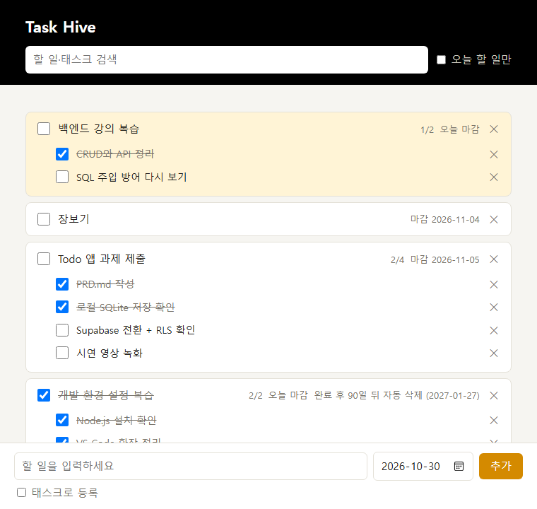
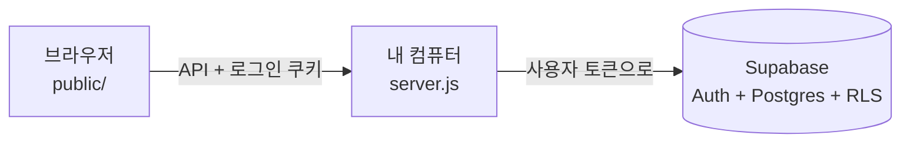
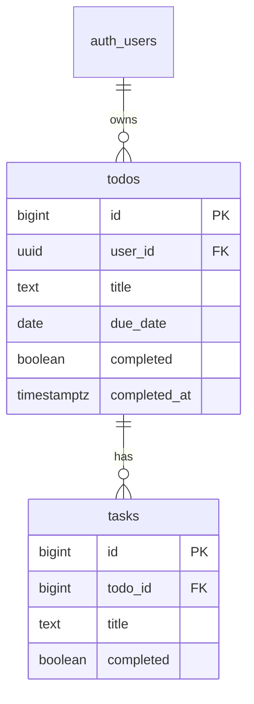

# TODO

큰 할 일(Todo) 아래에 하위 태스크(Task)를 두고 하나씩 체크하는 Todo 앱.
로그인하면 내 할 일만 보이고, 데이터는 클라우드 DB(Supabase)에 저장되어 껐다 켜도 남는다.

- **데모:** https://eple-lab.github.io/todo/ (서버 없이 브라우저에서만 동작, 새로고침하면 초기화)
- **기획서:** [docs/PRD.md](docs/PRD.md)
- **저장·보안 확인 기록:** [docs/verification.md](docs/verification.md)
- **문서 전체:** [docs/](docs/README.md)

## 화면



- 위쪽: 검색창(할 일·태스크 제목), "오늘 할 일만" 보기, 로그인한 이메일과 로그아웃
- 가운데: 할 일과 하위 태스크. 진행률(2/4), 마감일, 완료한 할 일의 자동 삭제 날짜가 오른쪽에 표시된다. 오늘 마감인 할 일은 노란 배경
- 아래쪽: 할 일 등록(마감일 기본값 오늘). "태스크로 등록"을 체크하면 넣을 할 일을 고른다

## 주요 기능

- 이메일 회원가입·로그인 (Supabase Auth), **내 할 일만 보기** (RLS)
- 할 일 추가·완료·삭제, 하위 태스크 추가·완료·삭제
- 안 끝난 태스크가 있는 할 일을 완료하거나, 태스크가 있는 할 일을 지울 때 확인
- 할 일·태스크 제목 검색, 오늘 할 일만 보기
- 마감일 필수(기본값 오늘, 지난 날짜 금지), 중복 제목 금지
- 완료 후 90일 지나면 자동 삭제

규칙 전체는 [docs/business-rules.md](docs/business-rules.md).

## 실행 방법

필요한 것: Node.js 24 이상, Supabase 무료 프로젝트

1. Supabase 프로젝트를 만들고 [db/supabase/01_schema.sql](db/supabase/01_schema.sql)을 SQL Editor에서 실행한다.
2. `.env.example`을 `.env`로 복사하고 `SUPABASE_URL`, `SUPABASE_PUBLISHABLE_KEY`를 채운다.
3. 실행:
   ```bash
   npm install
   npm start
   ```
4. http://localhost:3000 → 회원가입 → 사용

단계별 설명은 [docs/supabase-setup.md](docs/supabase-setup.md), 백업·문제 해결은 [docs/operations.md](docs/operations.md).

> 길 A(로컬 SQLite) 버전은 `git checkout path-a`로 볼 수 있다. Supabase 없이 `npm install && npm start`만으로 돈다.

## 구조



화면은 백엔드에만 요청하고, Supabase 주소와 키는 서버의 `.env`에만 있다.

```
server.js              백엔드: API 창구, 로그인, 규칙 검사
supabase.js            요청마다 그 사용자로 Supabase에 접속 (httpOnly 쿠키)
db.js                  DB 접근 코드는 전부 여기에만
db/supabase/           표·RLS·함수 SQL (Supabase SQL Editor에서 실행)
public/                화면(프론트): 백엔드 API에만 요청한다
public/demo-api.js     GitHub Pages 데모용 가짜 백엔드
scripts/rls-check.mjs  계정 두 개로 RLS 확인 (npm run check:rls)
docs/                  기획서와 문서, 화면 캡처
.github/workflows/     push하면 public/을 GitHub Pages에 올리는 설정
```

자세한 구조는 [docs/architecture.md](docs/architecture.md).

## DB 구조

표 2개, **todos 1 : N tasks**. 할 일마다 주인(`user_id`)이 있고, RLS로 자기 행만 다룬다.



열 설명, 제약조건, RLS 정책, 색인은 [docs/database.md](docs/database.md). API는 [docs/api.md](docs/api.md).

## 문서

| 문서 | 내용 |
|---|---|
| [PRD](docs/PRD.md) | 만들 기능과 조건 |
| [확인 기록](docs/verification.md) | 로컬·클라우드 저장, RLS 확인 결과 (과제용) |
| [Supabase 연결](docs/supabase-setup.md) | 프로젝트 만들기부터 RLS 확인까지 |
| [규칙](docs/business-rules.md) | 앱이 지키는 규칙, 어디서 막는지 |
| [구조](docs/architecture.md) | 파일별 역할, 로그인·요청 흐름 |
| [데이터베이스](docs/database.md) | 표·열·제약·RLS·색인 |
| [API](docs/api.md) | 주소, 요청·응답 예시 |
| [보안](docs/security.md) | RLS, 쿠키, SQL 주입, XSS, 키 관리 |
| [운영](docs/operations.md) | 실행, 백업과 복구, 문제 해결 |
| [테스트](docs/testing.md) | 체크리스트, 테스트 기록 |
| [배포](docs/deployment.md) | GitHub Pages 데모, Render 배포 준비물 |
| [결정 기록](docs/decisions.md) | 왜 이렇게 만들었는지 |
| [로드맵](docs/roadmap.md) | 진행 기록, 과제 대응 |
| [회고](docs/retrospective.md) | 강의 회고 노트 |

## 진행 기록

- [x] 길 A: 로컬 SQLite로 구현 (`path-a` 태그)
- [x] 길 B: Supabase로 저장소 전환 + 로그인 + RLS (코드 완료)
- [ ] 길 B: 실제 Supabase 프로젝트에서 저장·RLS 확인
- [ ] 길 C(선택): Render 배포

자세한 내용은 [docs/roadmap.md](docs/roadmap.md).
