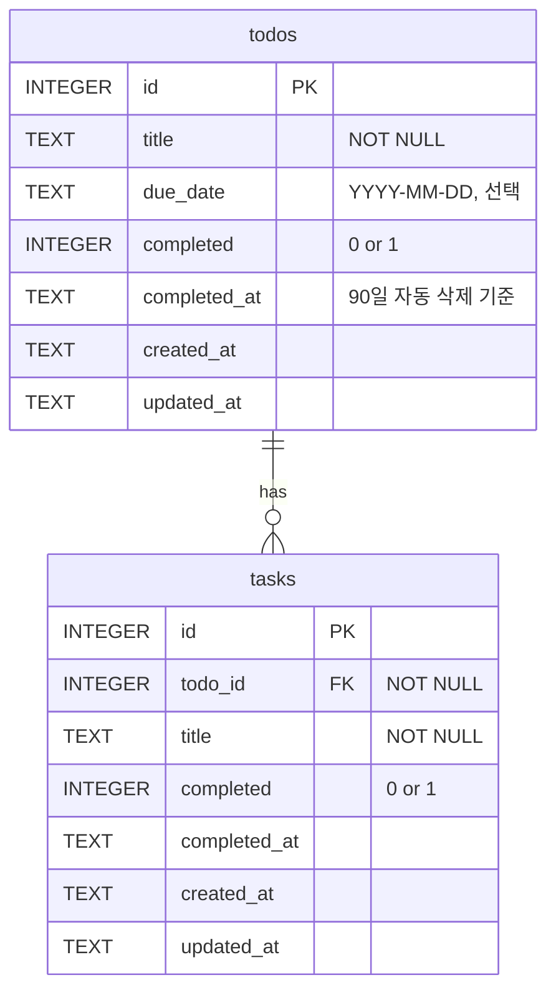

# Task Hive

큰 할 일(Todo) 아래에 하위 태스크(Task)를 두고 하나씩 체크하는 Todo 앱.
데이터는 내 컴퓨터의 SQLite 파일에 저장되어 껐다 켜도 남는다.

만들 기능과 조건은 [PRD.md](PRD.md)에 있다.

## 실행 방법

필요한 것: Node.js 24 이상 (SQLite가 Node에 내장되어 있어 따로 설치할 DB가 없다)

```bash
npm install
cp .env.example .env   # 선택: 포트나 DB 위치를 바꾸고 싶을 때만
npm start
```

브라우저에서 http://localhost:3000 을 연다.

- DB 파일은 처음 실행할 때 `data/todo.db`에 자동으로 만들어진다.
- `data/`와 `.env`는 Git에 올리지 않는다. 코드를 받은 사람은 빈 DB로 시작한다.
- 백업은 서버를 끈 뒤 `data/todo.db` 파일을 다른 곳에 복사하면 된다.

## 폴더 구조

```
server.js        백엔드: API 창구(엔드포인트)와 규칙 검사
db.js            DB 접근 코드는 전부 여기에만 있다 (길 B에서 이 파일을 Supabase용으로 바꾼다)
db/schema.sql    표를 만드는 SQL
public/          화면(프론트): 백엔드 API에만 요청한다
data/todo.db     실제 데이터 (자동 생성, Git 제외)
```

## DB 구조

표 2개, **todos 1 : N tasks** (일대다).



### todos - 큰 할 일

| 열 | 타입 | 설명 |
|---|---|---|
| `id` | INTEGER PK | 자동 증가 번호 |
| `title` | TEXT NOT NULL | 할 일 제목. 빈 글자 금지 |
| `due_date` | TEXT | 마감일 `YYYY-MM-DD`. 새로 등록할 때는 필수이고 오늘 이후만 가능(백엔드 검사) |
| `completed` | INTEGER | 0 = 미완료, 1 = 완료 |
| `completed_at` | TEXT | 완료한 시각(UTC). 미완료면 NULL. **이 시각부터 90일 뒤 자동 삭제** |
| `created_at` | TEXT | 만든 시각(UTC) |
| `updated_at` | TEXT | 마지막으로 바꾼 시각(UTC) |

### tasks - 하위 태스크

| 열 | 타입 | 설명 |
|---|---|---|
| `id` | INTEGER PK | 자동 증가 번호 |
| `todo_id` | INTEGER NOT NULL FK → `todos.id` | 어느 Todo에 속하는지. **NOT NULL이라 Todo 없는 태스크는 만들 수 없다** |
| `title` | TEXT NOT NULL | 태스크 제목 |
| `completed` | INTEGER | 0 = 미완료, 1 = 완료 |
| `completed_at` | TEXT | 완료한 시각(UTC) |
| `created_at` | TEXT | 만든 시각(UTC) |
| `updated_at` | TEXT | 마지막으로 바꾼 시각(UTC) |

### 관계와 규칙

- **1:N** - Todo 하나에 태스크 여러 개. 태스크 아래에 또 태스크는 없다(한 단계만).
- **함께 삭제** - Todo를 지우면 그 태스크도 지워진다(`ON DELETE CASCADE`).
- **DB가 직접 막는 것(CHECK 제약)** - 빈 제목, 잘못된 날짜 형식, `completed`가 1인데 `completed_at`이 비어 있는 상태.
- **색인** - `tasks.todo_id`(Todo별 태스크), `todos.due_date`(오늘 할 일), `todos.completed_at`(자동 삭제).
- SQLite는 날짜 타입이 없어서 날짜·시각을 글자(TEXT)로 저장한다. `YYYY-MM-DD` 형식이라 글자 순서로 정렬해도 날짜 순서와 같다.
- SQLite는 외래키 검사가 기본으로 꺼져 있어서 연결할 때마다 `PRAGMA foreign_keys = ON`을 실행한다.

### 백엔드가 지키는 규칙

화면에서도 막지만, 화면은 조작될 수 있으므로 백엔드에서 다시 검사한다.

- Todo 마감일은 필수이고 지난 날짜는 거절한다.
- 미완료 Todo끼리 같은 제목은 거절한다(대소문자 무시). 같은 Todo 안의 태스크끼리도 같은 제목은 거절한다.
- 완료된 Todo에는 태스크를 추가할 수 없다.
- 안 끝난 태스크가 있는 Todo를 완료하려면 확인(`force`)이 필요하다. 확인하면 남은 태스크도 함께 완료된다.
- 완료된 Todo의 태스크를 미완료로 되돌리면 Todo도 미완료로 돌아간다.
- 완료 후 90일이 지난 Todo는 서버가 켜질 때와 이후 6시간마다 자동 삭제된다.
- DB에 넣는 값은 모두 파라미터화 쿼리(`?` 자리표)로 넘긴다.

## API

| 메서드 | 주소 | 하는 일 |
|---|---|---|
| GET | `/api/todos?q=검색어&today=1` | Todo 목록(태스크 포함). `q`는 Todo·태스크 제목 검색, `today=1`은 마감일이 오늘인 것만 |
| POST | `/api/todos` | Todo 추가 `{ "title", "due_date" }`. 날짜 없음·지난 날짜는 400, 중복 제목은 409 |
| PATCH | `/api/todos/:id` | 완료/미완료 `{ "completed": true, "force": false }`. 안 끝난 태스크가 있으면 409 |
| DELETE | `/api/todos/:id` | Todo 삭제(태스크도 함께) |
| POST | `/api/todos/:id/tasks` | 태스크 추가 `{ "title" }`. 완료된 Todo거나 같은 이름의 태스크가 있으면 409 |
| PATCH | `/api/tasks/:id` | 태스크 완료/미완료 `{ "completed": true }` |
| DELETE | `/api/tasks/:id` | 태스크 삭제 |

## 진행 기록

- [x] 길 A-1: PRD 작성, DB 구조 설계
- [x] 길 A-2: 로컬 SQLite로 구현
- [ ] 길 B: Supabase로 저장소 전환 + 로그인 + RLS
- [ ] 길 C(선택): Render 등에 배포
