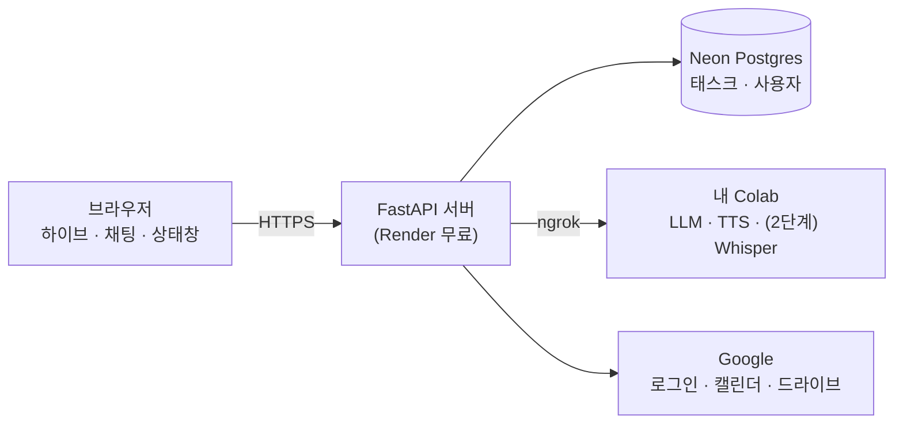

# 🐝 Task Hive

> 저녁에 일기 쓰듯 AI와 이야기하면, 할 일이 벌집에 쌓인다.

**지금 상태: 기획 단계.** 이 저장소에는 아직 문서만 있다. 실행할 코드는 없다. (2026-11-17 기준)

## Task Hive는 무엇인가

할 일 앱은 할 일을 **이미 알고 있는 사람**이 적는 도구다. Task Hive는 그 앞 단계를 맡는다. 하루를 돌아보며 AI와 편하게 이야기하면, AI가 대화 속에서 할 일을 찾아 "이건 담아 둘까요?"라고 묻는다. 담은 할 일은 육각형 벌집 한 칸이 되고, 끝낼수록 꿀이 찬다.

- **대화로 할 일 모으기**: 내 Colab에 올린 LLM과 글로 이야기한다. AI는 목소리로도 답한다(켜고 끌 수 있다).
- **벌집에 쌓기**: 모은 할 일을 "벌집으로 옮기기"로 등록하면 꿀통을 든 벌이 벌집으로 날아간다.
- **조심스러운 확인**: 등록한 할 일 이야기가 나오면 진행 상황을 부드럽게 묻고, "그건 한 것 같아"라고 하면 체크해 준다.
- **구글 시트로 내보내기** (켜고 끌 수 있음): 벌집의 할 일을 내 구글 시트에 사본으로 남긴다.
- **구글 캘린더 가져오기** (켜고 끌 수 있음): 내가 소유한 캘린더의 지난 7일과 앞으로 30일 일정을 읽어 할 일 후보로 보여 준다.
- **오늘의 일기** (켜고 끌 수 있음): 대화를 요약해 내 구글 드라이브의 시트나 Docs에 적는다.
- **로그인 없이도**: 이름만 적고 쓸 수 있다. 내려받으면 바로, 아니면 24시간 뒤 지워진다.

## 화면

```
┌───────────────┬─┬───────────────────────────┬─┬──────────────────┐
│  하이브       │◀│ ⓘ 이 대화는 내 Colab으로  │▶│ 연결             │
│  (벌집)       │ │    전송돼요               │ │ 후보             │
│               │ │                           │ │ 하이브 등록 예정 │
│   ⬡ ⬡        │ │   채팅                    │ │ [벌집으로 옮기기]│
│  ⬡ ⬡ ⬡      │ │                           │ │ 캘린더           │
│   ⬡ ⬡        │ │                           │ │ 일기             │
│               │ ├───────────────────────────┤ │ ▸ 목소리 설정    │
│ [구글시트 가기]│ │ 입력창          🔊 [보내기]│ │ ▸ 대화 설정      │
└───────────────┴─┴───────────────────────────┴─┴──────────────────┘
   왼쪽 (접힘 가능)        가운데                 오른쪽 (접힘 가능)
```

자세한 화면 구조: [docs/04-screens.md](docs/04-screens.md)

## 구조



| 영역 | 사용 (예정) |
|---|---|
| 서버 | Python, FastAPI |
| 화면 | React + Vite, 벌집은 SVG |
| DB | Neon Postgres |
| 배포 | Render 무료 |
| LLM | Colab + vLLM (OpenAI 호환), ngrok으로 연결 |
| 말하기 | Colab TTS 모델, 꺼져 있으면 브라우저 내장 음성 |
| 받아쓰기 | Colab Whisper (2단계) |
| 로그인 | Google OpenID Connect 또는 손님 모드 |

자세한 구조: [docs/03-architecture.md](docs/03-architecture.md)

## 사용하는 AI 모델

메인 퀘스트 조건(배운 모델을 1개 이상 직접 실행)에 맞춰 Colab에서 직접 돌린다. 어떤 모델을 쓸지는 비교 실험 뒤에 정한다.

| 역할 | 하는 일 | 후보 |
|---|---|---|
| 텍스트 생성 (LLM) | 대화, 할 일 추출, 일기 요약 | Qwen 4B급 양자화 모델 등 |
| 음성 생성 (TTS) | 답을 목소리로 읽기 | MeloTTS-Korean, Supertonic 2, XTTS-v2 |
| 음성 인식 (STT) | 말로 입력하기 (2단계) | Whisper |

실험 계획: [docs/poc/](docs/poc/README.md)

## 내 데이터는 어디에 있나

| 데이터 | 있는 곳 | 서버에 남나 |
|---|---|---|
| 대화 내용 | 브라우저, 전송 중에만 서버와 내 Colab | **남지 않는다** |
| 일기 | 내 구글 드라이브 (손님은 내려받은 파일) | **남지 않는다** |
| 할 일 | Neon DB (암호화 저장 제안), 사본은 내 구글 시트 | 남는다 |
| 캘린더 일정 | 고른 것만 할 일로 | 고르지 않은 것은 남지 않는다 |
| 구글 이메일·이름 | 받지 않는다 | **남지 않는다** |
| 목소리 | 저장하지 않는다 | **남지 않는다** |

- 채팅창 위에 "이 대화는 외부(내 Colab)로 전송된다"는 안내를 항상 보여 준다.
- 구글 권한은 필요한 것만, 사용자가 기능 연결을 누를 때 받는다. 구글 토큰은 약 1시간짜리만 쓰고 오래 가는 토큰은 받지 않는다.
- 자세한 내용: [docs/05-security.md](docs/05-security.md)

## 문서

| 문서 | 내용 |
|---|---|
| [docs/README.md](docs/README.md) | 문서 목차, 용어, 표기 규칙 |
| [01 사용자 요구사항](docs/01-requirements.md) | 무엇을 만드는가 |
| [02 결정 기록](docs/02-decisions.md) | 왜 이렇게 정했는가 |
| [03 아키텍처](docs/03-architecture.md) | 구성 요소, 폴더 구조, 데이터 이동, 로컬 실행 |
| [04 화면 구조](docs/04-screens.md) | 3단 화면, 로그인 단계, 벌집, 상태창 |
| [05 보안과 DevSecOps](docs/05-security.md) | 개인정보, 토큰, 위협과 대응, 파이프라인 |
| [06 로드맵](docs/06-roadmap.md) | 단계별 범위와 완료 기준 |
| [07 열린 질문](docs/07-open-questions.md) | 아직 정하지 않은 것 |
| [08 성능 검토 화면](docs/08-performance-review.md) | 운영 지표와 PoC 검증 화면 |
| [09 확인 기록](docs/09-verification.md) | 공식 문서로 확인한 사실과 출처 |
| [확인사항](docs/checks/README.md) | 자세히 확인한 주제별 문서 (구글 로그인 7일 만료, Docs 이미지 등) |
| [PoC](docs/poc/README.md) | 직접 실행해 확인할 실험 계획과 기록 |

## 로드맵

| 단계 | 내용 | 상태 |
|---|---|---|
| 0 | 기획: 요구사항, 아키텍처, 문제 정의서 | 진행 중 |
| 1 | 대화로 벌집 쌓기 (손님 모드, 대화, 추출, 벌집, TTS) | 예정 |
| 2 | 구글 로그인, 캘린더, 일기, 말로 입력 | 예정 |
| 3 | 배포, 성능 화면, 보안 파이프라인 | 예정 |
| 4 | 3D 벌집, 칸 옮기기, 검색 | 예정 |
| 5 | 구독·결제 | 예정 |

자세한 내용: [docs/06-roadmap.md](docs/06-roadmap.md)

## 실행 방법

**아직 실행할 코드가 없다.** 1단계가 끝나면 이 자리에 실제 명령을 적는다. 계획한 순서는 아래와 같다.

1. Colab에서 `colab/task_hive_server.ipynb`를 내 구글 계정으로 열고 런타임을 GPU로 바꾼다.
2. ngrok 토큰을 Colab 보안 비밀에 넣고 셀을 순서대로 실행한다. 마지막 셀이 ngrok 주소와 접속 키를 보여 준다.
3. 내 컴퓨터에서 가상환경을 만들고 의존성을 설치한다. `frontend/`에서 화면을 빌드한다(Node 필요).
4. `.env.example`을 `.env`로 복사한다. 비워 두어도 손님 모드로 돌아간다.
5. 서버를 켜고 `http://localhost:8000`을 연다.
6. 이름을 적거나 구글 로그인을 하고, 오른쪽 상태창에 ngrok 주소와 접속 키를 넣는다.

자세한 계획: [docs/03-architecture.md 8장](docs/03-architecture.md)

### Colab을 쓸 때 알아 둘 것

- Colab은 **과제용 실험 환경**으로 쓴다. LLM이 한국어 대화를 요약하고 할 일을 뽑을 수 있는지 확인하는 것이 목적이다.
- Colab 무료는 자원이 보장되지 않고 세션이 끊길 수 있다. 계속 켜 두는 서비스의 기반으로 쓰지 않는다.
- 본인이 띄운 Colab 주소만 넣는다. 남의 주소를 넣으면 대화가 그 사람에게 간다.

## 과제 정보

AIFFEL 「AI 이해하고 사용하기」 메인 퀘스트 2 "내 도메인에서 AI로 개선 지점 찾아서 PoC 만들기"의 결과물이다.

| 제출물 | 위치 | 상태 |
|---|---|---|
| 문제 정의서 | `docs/` | 작성 전 |
| PoC 코드·노트북 (모델 선정 근거 포함) | `app/`, `colab/`, `docs/poc/` | 계획만 있음 |
| 개선 효과 검증 (기존 방식 비교, 실패 사례) | `eval/`, `docs/poc/` | 계획만 있음 |
| README (실행 방법, 시연 자료) | 이 파일 | 기획 단계 내용만 |

## 배우며 만든 것에서 가져온 것

| 가져온 것 | 프로젝트 |
|---|---|
| 할 일·하위 태스크 규칙, 화면·서버·DB 세 곳 검사, 테스트 방식 | `todo` |
| Colab vLLM + ngrok 스트리밍 프록시 | `llm-chatbot` |
| 구글 로그인, 토큰 암호화, Neon, 시트 저장, 손님 모드, 보안 규칙 | `honey-voice-log` |
