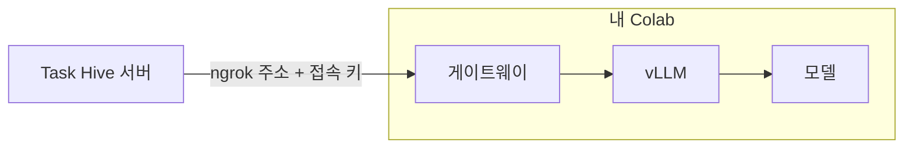

# Colab 노트북 사용법

`task_hive_server.ipynb`는 내 구글 계정의 Colab(GPU)에서 대화 모델을 띄우고, Task Hive가 붙을 수 있는 주소를 열어 주는 노트북이다.

> **상태**: 2026-11-18 Colab GPU에서 0~5번 셀(설치, vLLM, 게이트웨이)과 8번 셀(PoC-01 측정)을 실행해 확인했다. 6·7번 셀(ngrok)은 토큰 오류를 고친 뒤([12-fixes F-03](../docs/12-fixes.md#f-03)) 다시 확인해야 한다. "확인 필요"라고 적힌 값(문맥 길이, GPU 메모리 비율)은 아직 재지 않았다.

## 먼저 알아 둘 것

- 이 노트북은 **과제용 실험 환경**이다. LLM이 한국어 대화를 요약하고 할 일을 뽑을 수 있는지 확인하는 데 쓴다. ([docs/checks/colab-usage.md](../docs/checks/colab-usage.md))
- Colab 무료는 GPU를 보장하지 않고, 쓰지 않으면 끊기고, 최대 실행 시간이 있다. 계속 켜 두는 서비스로 쓰지 않는다.
- 대화 내용은 Task Hive 서버를 거쳐 **내 Colab**으로 간다. 남의 Colab 주소를 넣으면 대화가 그 사람에게 간다.

## 준비 (한 번만)

| 준비물 | 방법 |
|---|---|
| 구글 계정 | [Colab](https://colab.research.google.com)에 로그인한다 |
| ngrok 계정 | [ngrok](https://ngrok.com)에 가입하고 대시보드에서 Authtoken을 복사한다 |
| 보안 비밀 | Colab 왼쪽 **열쇠 아이콘** → 이름 `NGROK_AUTHTOKEN`(앞뒤 공백 없이), 값에 ngrok 대시보드 **Your Authtoken**의 토큰만(Copy 버튼으로) → "노트북 액세스"를 켠다. 고정 도메인이 있으면 `NGROK_DOMAIN`도 같은 방법으로 넣는다 |

토큰을 노트북 셀에 직접 붙여 넣지 않는다. 파일에 남아 저장소에 올라갈 수 있다.

## 실행 순서

1. 위 **Open in Colab** 배지를 누른다. GitHub의 노트북이 Colab에서 바로 열린다. 고친 내용을 남기려면 `파일 → 드라이브에 사본 저장`을 한다. (배지 대신 `파일 → 노트북 업로드`로 `task_hive_server.ipynb`를 열어도 된다)
2. `런타임 → 런타임 유형 변경`에서 하드웨어 가속기를 **GPU**로 바꾼다.
3. 셀을 위에서부터 차례로 실행한다.

| 셀 | 하는 일 | 걸리는 시간 |
|---|---|---|
| 0 설정 | 모델 이름, 문맥 길이, GPU 메모리 비율 | 바로 |
| 1 설치 | GPU 확인, 패키지 설치 | 몇 분 |
| 2 vLLM 실행 | 모델을 내려받아 GPU에 올린다 | 몇 분 |
| 3 대기 | 준비될 때까지 기다린다 | 2번에 포함 |
| 4 접속 키 | 무작위 접속 키를 만든다 | 바로 |
| 5 게이트웨이 | 접속 키를 확인하는 작은 서버를 띄운다 | 바로 |
| 6 ngrok | 주소를 열고 **주소와 접속 키**를 보여 준다 | 바로 |
| 7 확인 | 밖에서 닿는지 확인, GPU 메모리 출력 | 바로 |
| 8 PoC-01 | 가상 대화 20건으로 할 일 추출을 잰다 | 몇 분 |
| 9 끄기 | 터널과 서버를 끈다 | 바로 |

4. 6번 셀이 보여 준 **ngrok 주소**와 **접속 키**를 Task Hive 오른쪽 상태창의 "연결" 구역에 넣고 "연결 확인"을 누른다.
5. 다 쓰면 9번 셀을 실행하고 `런타임 → 런타임 연결 해제 및 삭제`를 한다.

## 접속 키

- 주소를 아는 사람이 누구나 내 Colab의 모델을 쓰지 못하게 하는 비밀번호다.
- 노트북을 새로 실행할 때마다 바뀐다. Task Hive에 다시 넣어야 한다.
- 채팅, 문서, 저장소에 붙여 넣지 않는다.

## 끊겼을 때

| 증상 | 원인 | 할 일 |
|---|---|---|
| Task Hive에 "Colab에 연결되지 않았어요" | 세션이 끊겼거나 터널이 닫혔다 | Colab 화면을 확인하고 2번 셀부터(런타임이 초기화됐으면 0번부터) 다시 실행한다. 접속 키가 바뀌었으면 다시 넣는다 |
| 3번 셀에서 "vLLM 이 종료됐다" | 메모리 부족, 설치 버전 문제 | 로그를 보고 `MAX_MODEL_LEN`이나 `GPU_MEMORY_UTILIZATION`을 낮춘다 |
| 5번 셀에서 "키 넣고: 200"이 안 나온다 | 게이트웨이가 뜨지 못했다 | `gateway.log`를 본다 |
| 0번 셀에서 "보안 비밀 'NGROK_AUTHTOKEN'을 읽지 못했다" | 보안 비밀 이름이 다르거나(앞뒤 공백 포함) 노트북 액세스가 꺼져 있다 | 이름이 정확히 `NGROK_AUTHTOKEN`인지, 노트북 액세스 스위치가 켜져 있는지 본다 |
| 6번 셀에서 `ERR_NGROK_105` (authtoken 모양이 아니다) | 토큰이 아닌 값(API Key 등)이나 명령어 줄을 통째로 넣었다 | 대시보드 Your Authtoken 페이지의 Copy 버튼으로 다시 넣고 6번 셀을 다시 실행한다. 같은 오류가 남으면 새 셀에서 `from pyngrok import ngrok; ngrok.kill()` 후 다시 실행한다 |
| 답이 비어 있다 | 생각 과정(thinking)이 켜져 있다 | 게이트웨이가 기본으로 끈다. 요청에 `chat_template_kwargs`를 직접 넣었다면 `enable_thinking: false`인지 본다 |
| GPU를 받지 못한다 | 무료 사용 한도 | 시간을 두고 다시 시도한다 |

ngrok 무료 계정은 고정 도메인을 하나 준다. 보안 비밀 `NGROK_DOMAIN`에 넣으면 다시 켜도 주소가 같다. 비워 두면 ngrok이 정한 주소를 쓴다.

## 저장소에 올리기 전에

**출력을 지운다.** `수정 → 출력 모두 지우기`를 한 뒤 내려받는다. 출력에는 ngrok 주소와 접속 키가 남는다. 저장소의 노트북은 출력이 비어 있어야 한다.

## 추측으로 적은 부분 (실행하며 확인할 것)

| 내용 | 왜 추측인가 |
|---|---|
| vLLM 실행 명령과 옵션 | `llm-chatbot`은 이미 떠 있는 vLLM에 붙기만 했다. 띄우는 명령은 그 프로젝트에 없다 |
| `pip install vllm`이 Colab에서 그대로 되는지 | 버전에 따라 CUDA·torch와 맞지 않을 수 있다 |
| `MAX_MODEL_LEN = 8192`, `GPU_MEMORY_UTILIZATION = 0.80` | 받은 GPU에 따라 다르다. PoC-03에서 잰다 |
| 구조화 출력(`response_format`)을 vLLM이 받는 모양 | 측정 스크립트는 거절되면 옵션을 빼고 다시 시도한다 |
| `ngrok.connect(..., domain=...)` | pyngrok 버전에 따라 옵션 이름이 다를 수 있다 |

확인한 것은 `llm-chatbot`에서 읽은 내용이다: 모델 이름 `cyankiwi/Qwen3.5-4B-AWQ-4bit`, OpenAI 호환 `/v1/chat/completions`, `chat_template_kwargs: {"enable_thinking": false}`가 필요하다는 것, ngrok 호출에 `ngrok-skip-browser-warning` 헤더를 넣는 것.

## 2단계에 더할 것

- `/tts`: TTS 모델을 올려 음성을 돌려준다. 후보와 실험은 [docs/poc/poc-02-tts-korean-voices.md](../docs/poc/poc-02-tts-korean-voices.md)
- `/stt`: Whisper로 받아쓴다.
- 세 모델이 함께 올라가는지는 [docs/poc/poc-03-colab-gpu-memory.md](../docs/poc/poc-03-colab-gpu-memory.md)
