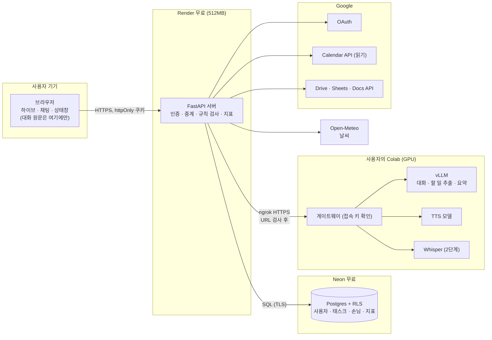
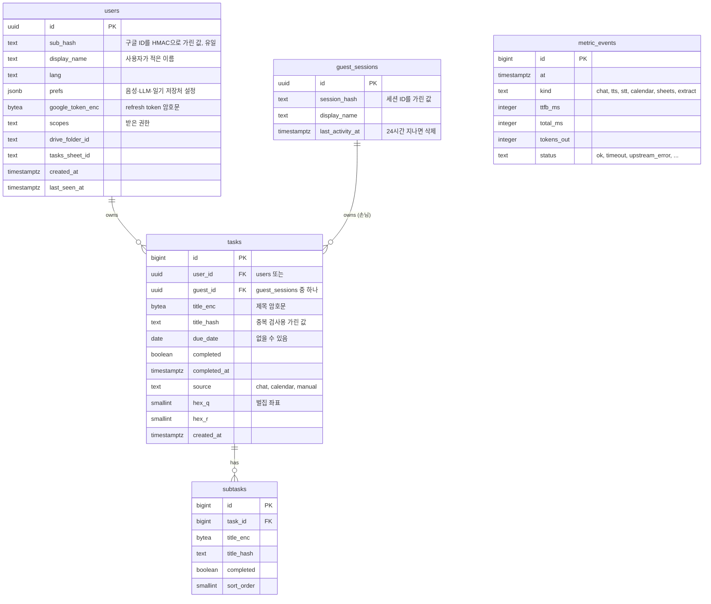
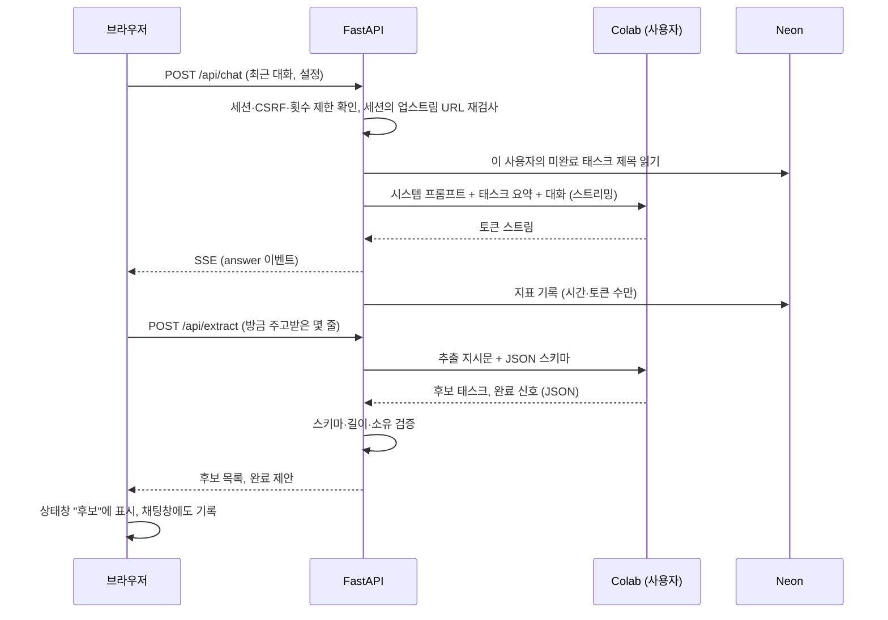
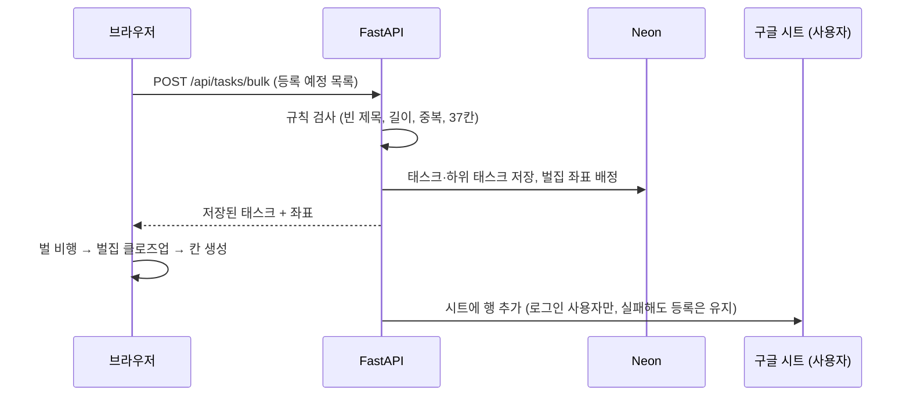

# 03. 아키텍처

작성일: 2026-11-17 · 표기: 확정 결정은 [D-번호](02-decisions.md), 제안은 [P-번호](02-decisions.md)

## 1. 엔터프라이즈 아키텍처 한눈에

네 개 층으로 나눠 본다. 위층의 요구가 아래층의 선택을 정한다.

| 층 | 질문 | Task Hive의 답 |
|---|---|---|
| 비즈니스 | 누가 무엇을 얻는가 | 사용자는 대화만으로 할 일을 정리하고 일기를 남긴다. 운영자는 개인 데이터를 거의 갖지 않는다 |
| 애플리케이션 | 어떤 기능 단위가 있는가 | 인증, 대화 중계, 할 일 추출, 태스크 관리, 캘린더 가져오기, 일기 저장, 음성, 지표 |
| 데이터 | 어떤 데이터가 어디에 있는가 | 대화는 브라우저, 태스크는 Neon, 일기는 사용자의 구글 드라이브, 지표는 숫자만 Neon |
| 기술 | 무엇으로 돌리는가 | Render(FastAPI), Neon(Postgres), Colab + ngrok(vLLM, TTS, Whisper), Google API, GitHub Actions |

### 설계 원칙

1. **데이터 최소화**: 저장하지 않아도 되는 것은 저장하지 않는다. (D-08)
2. **사용자 소유**: 일기는 사용자의 구글 드라이브에, 대화는 사용자의 Colab으로만 간다. (D-04)
3. **믿지 않기**: 화면, LLM 출력, 캘린더 내용, 사용자가 준 URL을 모두 검증한다. (P-06)
4. **여러 겹의 방어**: 화면, 서버, DB에서 같은 규칙을 검사한다. (P-04)
5. **꺼져도 동작**: Colab이나 구글이 안 돼도 벌집과 직접 체크는 된다.
6. **코드로 관리**: 배포 설정, DB 표, 파이프라인을 저장소에 둔다.

## 2. 시스템 구성도



브라우저는 **우리 서버에만** 요청한다. 구글 토큰, Colab 주소, 접속 키는 브라우저의 자바스크립트가 읽을 수 없는 곳에 둔다.

## 3. 구성 요소

| 구성 요소 | 역할 | 본받는 곳 |
|---|---|---|
| 프론트 (정적 파일) | 3단 화면, 대화 기록 보관(메모리), 벌집 그리기, 음성 재생과 효과 | `todo/public`, `llm-chatbot/static` |
| 인증 | 구글 로그인, 손님 세션, 세션 쿠키, CSRF | `honey-voice-log/app/security.py` |
| 대화 중계 | 사용자의 업스트림으로 SSE 스트리밍 중계, 시스템 프롬프트 삽입 | `llm-chatbot/server.py` |
| 할 일 추출 | 대화에서 후보 태스크·완료 신호를 JSON으로 뽑고 검증 | `honey-voice-log/app/llm.py` (JSON 스키마 강제) |
| 태스크 | 태스크·하위 태스크 CRUD, 규칙 검사, 시트 내보내기 | `todo/server.js`, `todo/docs/business-rules.md` |
| 캘린더 | 일정 읽기(-7일 ~ +30일), 후보로 변환 | 새로 만듦 |
| 일기 | 요약 생성, 승인 후 시트/Docs 저장, 최근 3일 읽기 | `honey-voice-log/app/sheets.py` |
| 음성 | Colab TTS 중계, (2단계) 녹음 파일을 Whisper로 전달 | `honey-voice-log/app/stt.py` (구조만) |
| URL 검사 | 사용자가 넣은 ngrok 주소 검증, 연결 확인 | 새로 만듦 |
| 지표 | 숫자만 기록, 관리자 화면에 제공 | 새로 만듦 |
| 저장소 계층 | Postgres / 메모리 저장소를 같은 함수 이름으로 | `todo/db.js`, `honey-voice-log/app/store.py` |

## 4. 폴더 구조 (제안)

```
task-hive/
├── app/
│   ├── main.py                 앱 조립, 보안 헤더, 라우터 등록
│   ├── config.py               환경변수 읽기와 검사 (운영에서 비밀값 없으면 시작 거부)
│   ├── routers/
│   │   ├── auth.py             /auth/login, /auth/callback, /auth/guest, /auth/logout, /auth/delete
│   │   ├── chat.py             /api/chat (SSE 중계), /api/extract
│   │   ├── tasks.py            /api/tasks, /api/tasks/{id}/subtasks, 완료·되돌리기
│   │   ├── calendar.py         /api/calendar/consent, /api/calendar/events
│   │   ├── diary.py            /api/diary/summary, /api/diary/save, /api/diary/recent
│   │   ├── voice.py            /api/tts, /api/stt (2단계)
│   │   ├── settings.py         /api/settings (업스트림 URL, 언어, 음성·LLM 설정)
│   │   ├── export.py           /api/export (손님 MD 내려받기 → 삭제)
│   │   ├── admin.py            /admin, /api/admin/metrics
│   │   └── health.py           /health
│   ├── services/
│   │   ├── upstream.py         Colab 게이트웨이 호출 (LLM, TTS, STT)
│   │   ├── extraction.py       후보·완료 신호 추출과 검증
│   │   ├── google_oauth.py     로그인, 권한 추가 요청, 토큰 갱신·해제
│   │   ├── google_calendar.py  일정 읽기
│   │   ├── google_drive.py     폴더·시트·Docs 만들기와 쓰기
│   │   ├── weather.py          날씨
│   │   └── metrics.py          지표 기록과 집계
│   ├── security/
│   │   ├── session.py          세션 쿠키 (암호화, httpOnly)
│   │   ├── csrf.py             변경 요청 검사
│   │   ├── crypto.py           토큰·제목 암호화, 사용자 ID 가리기
│   │   ├── url_guard.py        업스트림 주소 검사 (SSRF 방어)
│   │   ├── rate_limit.py       요청 횟수 제한
│   │   └── sanitize.py         시트 수식 주입 방지, 길이 제한
│   ├── store/
│   │   ├── base.py             저장소 함수 목록
│   │   ├── postgres.py         Neon
│   │   ├── memory.py           로컬 개발용
│   │   └── migrations/         표·RLS·정리 작업 SQL
│   └── prompts/                시스템 프롬프트 (언어별), 추출 지시문
├── static/
│   ├── index.html              3단 화면
│   ├── admin.html              성능 검토 화면
│   ├── css/
│   └── js/
│       ├── api.js              서버 호출
│       ├── chat.js             채팅창, 스트리밍 표시, 대화 기록(메모리)
│       ├── hive.js             벌집 배치와 그리기
│       ├── bee.js              벌 비행·클로즈업 애니메이션
│       ├── panel.js            상태창
│       ├── voice.js            음성 재생, 에코·저음 효과, 대체 음성
│       ├── layout.js           패널 접기, 테마
│       └── i18n/               언어별 문구
├── colab/
│   └── task_hive_server.ipynb  vLLM + TTS + (2단계) Whisper + 게이트웨이 + ngrok
├── eval/
│   ├── samples/                검증용 가상 대화 (실제 개인 대화 금지)
│   ├── run_eval.py             추출 정확도·시간 측정
│   └── results/                결과 JSON (성능 화면이 읽는다)
├── tests/                      기본 기능, 보안 규칙, 화면 상태
├── docs/                       이 문서들 + 문제 정의서(과제 제출용)
├── .github/workflows/          CI, 보안 검사
├── render.yaml                 Render 설정 (비밀값은 키 이름만)
├── requirements.txt / requirements.lock
├── .env.example
└── README.md                   실행 방법, 노트북 사용법, 시연 자료
```

## 5. 데이터 구조 (제안)

### 5.1 어떤 데이터가 어디에 있나

| 데이터 | 민감도 | 있는 곳 | 보관 기간 |
|---|---|---|---|
| 대화 원문 | 매우 높음 | 브라우저 메모리. 전송 중에만 서버와 Colab을 지남 | 탭을 닫거나 새로고침할 때까지 |
| 일기 요약 | 매우 높음 | 사용자의 구글 드라이브 (손님은 내려받은 MD) | 사용자가 정함 |
| 태스크·하위 태스크 제목 | 높음 | Neon (암호화 저장 제안 P-03), 사본은 사용자의 구글 시트 | 완료 후 90일 (P-17) |
| 캘린더 일정 | 높음 | 서버 메모리에서 후보로 바꿔 브라우저로 전달. DB에 저장 안 함 | 요청 처리 중에만 |
| 구글 refresh token | 매우 높음 | Neon (암호화) | 탈퇴 또는 권한 해제까지 |
| 구글 사용자 ID | 중간 | Neon (HMAC으로 가린 값만) | 탈퇴까지 |
| 부를 이름 | 낮음 | Neon | 탈퇴까지, 손님은 24시간 |
| 업스트림 URL·접속 키 | 높음 | 암호화한 세션 쿠키 (DB에 저장 안 함) | 세션이 끝날 때까지 |
| 음성 (TTS 결과, 2단계 녹음) | 높음 | 메모리로만 전달 | 저장 안 함 |
| 지표 | 낮음 | Neon (숫자만, 사용자 구분 없음) | 30일 |

### 5.2 표



- `tasks`는 `user_id`와 `guest_id` 중 정확히 하나만 채운다(DB 제약).
- 사용자나 손님 행을 지우면 태스크·하위 태스크도 함께 지워진다(`ON DELETE CASCADE`).
- `metric_events`에는 사용자 구분 값과 대화 내용이 없다.
- 표 정의와 RLS는 `app/store/migrations/`에 SQL로 둔다.

### 5.3 자동 삭제

| 대상 | 조건 | 방법 |
|---|---|---|
| 손님 | 내려받기 직후 | `/api/export` 응답을 보낸 뒤 그 손님 행 삭제 |
| 손님 | 마지막 활동 24시간 뒤 | 요청이 들어올 때마다(최대 10분에 1번) 오래된 행 삭제. Render 무료는 잠들기 때문에 정해진 시각 작업에 기대지 않는다 |
| 완료된 태스크 | 완료 후 90일 (P-17) | 같은 정리 작업 |
| 지표 | 30일 | 같은 정리 작업 |

## 6. 데이터 이동

### 6.1 대화 한 번



- 서버는 대화 본문을 DB와 로그에 쓰지 않는다.
- LLM에 태스크 제목을 넘기는 것은 "등록된 태스크 이야기가 나오면 진행 상황을 확인한다"(R-CHAT-7)에 필요하다. 넘기는 곳은 사용자 본인의 Colab이다.

### 6.2 벌집 등록



시트 내보내기가 실패하면 등록은 그대로 두고 "시트 반영 실패, 다시 시도" 안내만 한다. 원본은 Neon이다(D-02).

### 6.3 완료 체크 ("그건 한 것 같아")

1. `/api/extract`가 완료 신호 `{task_ref, subtask_ref?, confidence}`를 낸다.
2. 서버가 그 태스크가 이 사용자의 것인지 확인한다.
3. [01 5.3의 표](01-requirements.md)대로 바로 체크하거나 확인을 요청한다.
4. 채팅창에 결과와 "되돌리기"를 남긴다. 벌이 날아와 꿀을 채운다.

### 6.4 캘린더 가져오기

1. 사용자가 캘린더 사용에 동의하면 그때 캘린더 읽기 권한을 요청한다(P-01).
2. 서버가 -7일 ~ +30일 일정을 읽어 제목·날짜만 남긴다. 참석자, 설명, 위치는 버린다.
3. 일정 제목은 **자료**다. LLM 지시문으로 쓰지 않고, 화면에는 글자로만 넣는다.
4. 브라우저 상태창에 일별 체크박스 목록으로 보여 준다. DB에는 사용자가 고른 것만 태스크로 들어간다.

### 6.5 일기 저장

1. 버튼을 누르면 브라우저가 오늘 대화를 서버로 보내 요약을 요청한다(서버는 저장하지 않고 Colab에 중계).
2. 채팅창에 요약과 "등록해 / 나중에" 버튼이 뜬다.
3. "등록해"면 서버가 사용자의 구글 드라이브 「테스크 하이브 일기」 폴더의 월별 파일에 쓴다.
4. 시트에 쓸 때는 `valueInputOption=RAW`로 보내 `=`로 시작하는 값이 수식으로 실행되지 않게 한다(`honey-voice-log` 방식).

### 6.6 말하기

1. 답 문장이 끝날 때마다 브라우저가 `/api/tts`에 문장을 보낸다.
2. 서버가 Colab TTS에 중계하고 음성 데이터를 그대로 돌려준다. 저장하지 않는다.
3. 브라우저가 Web Audio로 저음·에코·속도·볼륨을 입혀 재생한다.
4. Colab TTS가 실패하면 브라우저 내장 음성으로 읽고 "기본 음성으로 읽는 중"을 표시한다.

## 7. 서버 API 요약 (제안)

| 메서드·주소 | 설명 | 로그인 |
|---|---|---|
| `GET /health` | 서버 상태 | 불필요 |
| `GET /auth/login` → `/auth/callback` | 구글 로그인 | - |
| `POST /auth/guest` | 손님 시작 (이름) | - |
| `POST /auth/logout`, `POST /auth/delete` | 로그아웃, 탈퇴 | 필요 |
| `GET /api/me` | 이름, 언어, 설정, 받은 권한 | 필요 |
| `PUT /api/settings` | 언어, 음성·LLM 설정, 일기 저장처 | 필요 |
| `PUT /api/settings/upstream` | ngrok URL·접속 키 검사 후 세션에 저장 | 필요 |
| `GET /api/greeting` | 시각, 날씨, 최근 3일 일기 요약 | 필요 |
| `POST /api/chat` | 대화 (SSE) | 필요 |
| `POST /api/extract` | 후보·완료 신호 추출 | 필요 |
| `GET/POST /api/tasks`, `POST /api/tasks/bulk` | 조회, 등록 | 필요 |
| `PATCH/DELETE /api/tasks/{id}` | 수정, 완료, 삭제 | 필요 |
| `POST/PATCH/DELETE /api/tasks/{id}/subtasks/...` | 하위 태스크 | 필요 |
| `POST /api/calendar/consent`, `GET /api/calendar/events` | 캘린더 동의, 일정 읽기 | 구글 |
| `POST /api/diary/summary`, `POST /api/diary/save`, `GET /api/diary/recent` | 일기 | 구글 (요약은 손님도) |
| `POST /api/tts`, `POST /api/stt` | 말하기, 받아쓰기(2단계) | 필요 |
| `GET /api/export` | 손님 MD 내려받기 후 삭제 | 손님 |
| `GET /admin`, `GET /api/admin/metrics` | 성능 검토 | 관리자 |

"필요"는 구글 로그인 또는 손님 세션이다.

## 8. 실행 환경과 로컬 워크플로우

### 8.1 환경

| 환경 | 서버 | DB | LLM | 용도 |
|---|---|---|---|---|
| 로컬 | 내 컴퓨터 `localhost:8000` | 메모리 저장소 또는 Neon 개발 브랜치 (P-14) | 내 Colab | 개발, 과제 재현 |
| CI | GitHub Actions | 메모리 저장소 | 가짜 업스트림 | 테스트, 보안 검사 |
| 운영 | Render 무료 | Neon 운영 브랜치 | 각 사용자의 Colab | 데모 |

### 8.2 로컬 실행 순서

1. **Colab**: `colab/task_hive_server.ipynb`를 내 구글 계정으로 열고 런타임을 GPU로 바꾼다.
2. **Colab**: ngrok 토큰을 Colab 보안 비밀에 넣고 셀을 순서대로 실행한다. 마지막 셀이 ngrok 주소와 접속 키를 보여 준다.
3. **내 컴퓨터**: 가상환경을 만들고 `requirements.lock`으로 설치한다.
4. **내 컴퓨터**: `.env.example`을 `.env`로 복사한다. 비워 두어도 손님 모드로 돌아간다.
5. **내 컴퓨터**: 서버를 켜고 `http://localhost:8000`을 연다.
6. **화면**: 손님 이름을 적거나 구글 로그인한다. 상태창에 ngrok 주소와 접속 키를 넣고 "연결 확인"을 누른다.
7. **화면**: 대화한다.

`.env`를 비웠을 때의 동작(`honey-voice-log` 방식):

| 비운 값 | 동작 |
|---|---|
| `GOOGLE_CLIENT_ID/SECRET` | 구글 버튼이 숨겨지고 손님 모드만 된다 |
| `DATABASE_URL` | 메모리 저장소를 쓴다 (서버를 끄면 사라짐) |
| `SESSION_SECRET` 등 | 실행할 때마다 임시값을 만든다 |
| 업스트림 URL (화면 입력) | 대화·말하기가 꺼지고 벌집과 직접 등록만 된다 |

운영(`APP_ENV=production`)에서는 비밀값이 하나라도 없으면 서버가 켜지지 않는다.

### 8.3 운영 배포

- `render.yaml`(Blueprint)에 설정을 코드로 둔다. 비밀값은 키 이름만 적고 값은 Render 화면에 넣는다.
- `main`에 합쳐지고 CI가 통과하면 Render가 자동 배포한다.
- Render 무료 서버는 요청이 15분 없으면 잠들고 깨어나는 데 약 1분 걸린다. 화면에 "서버를 깨우는 중" 안내를 둔다.
- Render 무료는 512MB·0.1 CPU·인스턴스 1개·디스크 없음이고 언제든 재시작될 수 있다. Neon 무료는 5분 안 쓰면 멈추고 복구 가능 기간이 6시간이다. (2026-11-17 확인, [09 확인 기록](09-verification.md))
- 업스트림을 부를 때 `ngrok-skip-browser-warning` 헤더를 넣는다.

### 8.4 Colab 노트북 구성 (제안)

| 셀 | 내용 |
|---|---|
| 1 | 설치, GPU 확인 |
| 2 | vLLM으로 대화 모델 실행 (`llm-chatbot`은 `Qwen3.5-4B-AWQ-4bit` 사용) |
| 3 | TTS 모델 불러오기 |
| 4 | (2단계) Whisper 불러오기 |
| 5 | 게이트웨이: `/v1/chat/completions`, `/tts`, `/stt`, `/health`. 접속 키 확인 |
| 6 | ngrok 연결, 주소와 접속 키 출력 |

모델은 후보를 비교 실험한 뒤 정한다(P-16).

## 9. 뒤 단계를 위한 자리 (D-05)

| 뒤 단계 기능 | 지금 남겨 두는 자리 |
|---|---|
| 카카오 로그인 | `users`에 인증 수단을 구분하는 열을 추가할 수 있게 `sub_hash`를 "제공자:가린 ID" 형태로 만든다 |
| 구독·결제 | `routers/billing.py`, `subscriptions` 표를 추가한다. 카드 정보는 저장하지 않고 결제사가 맡는다 |
| 7개 무료 제한 | 태스크 개수 제한을 설정값으로 둔다 |
| 로컬 SQLite | 저장소 계층(`store/base.py`)에 SQLite 구현을 추가한다 |
| Three.js 3D | `hive.js`의 배치 계산과 그리기를 분리해 그리기만 바꾼다 |
| STT | `/api/stt`와 `services/upstream.py`에 자리를 둔다 |
