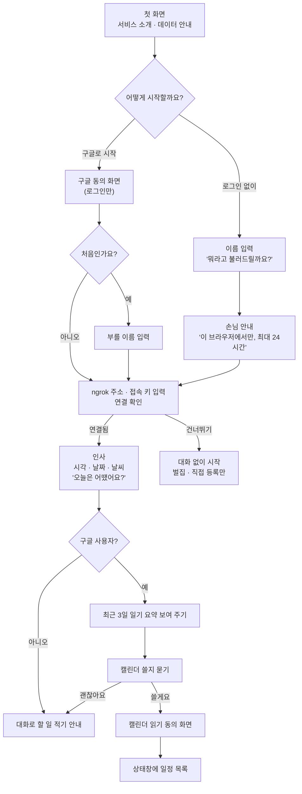
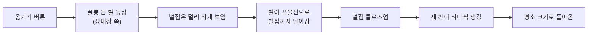

# 04. 화면 구조

작성일: 2026-11-17 · 세부 배치는 제안이다. 확정된 요구사항 번호는 [01](01-requirements.md)을 따른다.

## 1. 전체 배치

```
┌──────────────────────────────────────────────────────────────────────────────┐
│ 🐝 Task Hive                                   ○○님 · 언어 · 테마 · 로그아웃 │
├──────────────────┬─┬──────────────────────────────┬─┬────────────────────────┤
│                  │◀│ ⓘ 이 대화는 내 Colab(외부)   │▶│ 연결                   │
│   하이브         │ │    으로 전송돼요             │ │ 후보                   │
│   (벌집)         │ ├──────────────────────────────┤ │ 하이브 등록 예정       │
│                  │ │                              │ │ [벌집으로 옮기기]      │
│                  │ │   채팅                       │ │ 캘린더                 │
│                  │ │                              │ │ 일기                   │
│                  │ │                              │ │ ▸ 목소리 설정          │
│ [리스트로 보기]  │ ├──────────────────────────────┤ │ ▸ 대화 설정            │
│ [구글시트 가기]  │ │ 입력창            🔊 [보내기]│ │ 언어                   │
└──────────────────┴─┴──────────────────────────────┴─┴────────────────────────┘
      왼쪽 패널    접기        가운데 (항상 보임)    접기      오른쪽 패널
```

| 영역 | 내용 | 접기 |
|---|---|---|
| 왼쪽: 하이브 | 벌집, 리스트 보기, 구글시트 가기 | 가능 |
| 가운데: 채팅 | 외부 전송 안내, 대화, 입력창, 말하기 토글 | 불가 (항상 보임) |
| 오른쪽: 상태창 | 연결, 후보, 등록 예정, 캘린더, 일기, 설정 | 가능 |

### 접기 동작

- 패널 경계의 손잡이(◀ ▶)를 누르면 그 패널이 접혀 가느다란 띠만 남는다. 다시 누르면 펴진다.
- 접힌 상태는 브라우저에 기억한다(화면 설정일 뿐 개인정보가 아니다).
- 접힌 띠에 알림 점을 둔다. 예: 상태창이 접힌 동안 후보가 생기면 띠에 숫자가 뜬다.
- 벌집으로 옮길 때 왼쪽 패널이 접혀 있으면 자동으로 펴서 애니메이션을 보여 준다.

### 화면 폭에 따른 배치

| 폭 | 배치 |
|---|---|
| 넓음 (1200px 이상) | 3단 모두 표시 |
| 중간 (768~1199px) | 채팅 + 한쪽 패널. 다른 쪽은 접힌 채 시작 |
| 좁음 (767px 이하) | 채팅만. 하이브와 상태창은 아래 탭으로 전환 |

## 2. 로그인 단계



### 단계별 설명

| 단계 | 화면에 보이는 것 | 메모 |
|---|---|---|
| 첫 화면 | 서비스 한 줄 소개, "구글로 시작" / "로그인 없이 시작", 데이터 안내 링크 | 데이터 안내: 무엇을 어디에 두고 언제 지우는지 |
| 구글 동의 | 구글이 보여 주는 화면 | 처음에는 로그인(`openid`)만 요청한다. 드라이브와 캘린더 권한은 그 기능을 켤 때 요청한다 (P-01, D-14, D-15) |
| 이름 입력 | "뭐라고 불러드릴까요?" | 구글 이름·이메일은 받지 않는다 (P-02) |
| 손님 안내 | "이 브라우저에서만 이어지고, 내려받거나 24시간이 지나면 지워져요" | 확인을 눌러야 넘어간다 |
| 연결 | ngrok 주소, 접속 키, "연결 확인" 버튼, 노트북 사용법 링크 | 실패하면 이유를 쉬운 말로 안내 |
| 인사 | 시각·날짜·날씨에 맞춘 다정한 인사 + "오늘은 어땠어요?" | 채팅창에 표시, 말하기가 켜져 있으면 소리로도 |
| 최근 일기 | 최근 3일을 하루 1~2줄로 | 일기가 없으면 건너뛴다 |
| 캘린더 | "캘린더 일정을 살펴볼까요? 지난 7일과 앞으로 30일만 읽어요" + 예/아니오 버튼 | 아니오면 "대화하며 일기 적듯 할 일을 적을 수 있어요" |

## 3. 가운데: 채팅

### 구성

| 요소 | 설명 |
|---|---|
| 외부 전송 안내 | 채팅창 맨 위에 항상 보인다. "이 대화는 입력하신 Colab 주소(외부)로 전송돼요. 서버에는 저장하지 않아요." 연결 상태 점(초록/회색)을 함께 둔다 |
| 말풍선 | AI(왼쪽), 사용자(오른쪽), 시스템 알림(가운데, 작게) |
| 행동 버튼 | AI 말풍선 아래에 붙는 버튼. 예: "등록해 / 나중에", "예 / 아니오", "되돌리기" |
| 입력창 | 여러 줄 입력, Enter 전송, Shift+Enter 줄바꿈 |
| 말하기 토글 | 🔊 켜기/끄기. 끄면 재생 중인 소리도 멈춘다 |
| 마이크 | 2단계 (D-10) |

### 모든 일은 채팅창에 남는다 (R-CHAT-5)

상태창에서 한 일도 채팅창에 시스템 알림으로 적는다.

| 상태창에서 한 일 | 채팅창에 남는 글 (예) |
|---|---|
| 캘린더 일정 3개 선택 | "캘린더에서 3개를 등록 예정에 담았어요: …" |
| 벌집으로 옮기기 | "5개를 벌집에 올렸어요 🐝" |
| 후보 지우기 | "'장보기'를 후보에서 뺐어요" |
| 일기 저장 | "오늘 일기를 구글 시트에 적었어요" |
| 설정 변경 | 남기지 않는다 (대화가 아니다) |

### 버튼과 글 입력은 같은 결과

"등록할까요?"에 버튼 "등록해"를 누르든 글로 "등록해줘"라고 쓰든 같은 동작이다. 버튼을 누르면 사용자 말풍선으로 "등록해"가 적힌다.

### 대화 말투 규칙 (시스템 프롬프트에 넣을 내용)

- 다정하고 짧게 말한다. 한 번에 질문 하나만 한다.
- 할 일을 캐묻지 않는다. 하루 이야기를 듣다가 할 일이 보이면 "이건 할 일로 담아 둘까요?"라고 묻는다.
- 진행 확인은 사용자가 그 태스크 이야기를 꺼냈을 때만 한다. 먼저 꺼내는 것은 하루에 한 번까지다.
- "아직", "못 했어"라는 답에는 재촉하지 않고 공감한 뒤 넘어간다.
- 모르는 것은 지어내지 않는다.

## 4. 왼쪽: 하이브

### 벌집 칸

```
      ___
     /   \        제목 (5글자까지, 넘으면 …)
    / D-3 \       D-day (없으면 표시 없음)
    \ ▓▓░ /       꿀 높이 = 완료한 하위 태스크 / 전체
     \___/        하위 태스크가 없으면 완료 시 가득
```

| 상태 | 모양 |
|---|---|
| D-day 있음 | 칸 위쪽에 D-N. 오늘이면 D-DAY, 지났으면 D+N |
| D-day 없음 | 날짜 표시 없음 |
| 진행 중 | 꿀이 비율만큼 차 있다 |
| 완료 | 꿀이 가득, D-day 자리에 붉은 DONE |
| 테마 | 라이트: 노란 꿀 / 다크: 파란 꿀 |

칸을 누르면 그 태스크의 상세가 열린다: 전체 제목, D-day, 하위 태스크 체크박스, 완료·삭제.

### 벌집이 채워지는 구조

칸은 가운데에서 시작해 바깥 고리로 채운다.

| 고리 | 추가되는 칸 | 누적 |
|---|---|---|
| 중심 | 1 | 1 |
| 1단 | 6 | 7 |
| 2단 | 12 | 19 |
| 3단 | 18 | 37 |

- n번째 고리에는 6 × n칸이 있다. 3단까지 37칸이 최대다(초안).
- 새 태스크는 비어 있는 칸 중 가장 안쪽 고리의 칸에 들어간다. 같은 고리 안에서는 무작위로 골라 "랜덤스럽게" 보이게 한다(초안).
- 좌표는 육각 격자 좌표 `(q, r)`로 DB에 저장한다. 다시 열어도 같은 자리에 있다.
- 37칸을 넘길 때의 처리는 [07 Q-10](07-open-questions.md).

### 등록 애니메이션 (R-HIVE-4)



- 전체 2~3초. 여러 개를 한 번에 옮기면 벌은 한 번 날고 칸이 순서대로 생긴다.
- 화면을 누르면 건너뛴다.
- 기기 설정이 "움직임 줄이기"면 벌 비행 없이 칸만 부드럽게 나타난다.
- 서버 저장이 성공한 뒤에 애니메이션을 시작한다. 실패하면 애니메이션 없이 오류를 알린다.

### 완료 애니메이션

하위 태스크나 태스크를 체크하면 벌이 그 칸으로 날아와 꿀을 채운다. 다 차면 DONE으로 바뀐다(초안).

### 리스트로 보기

벌집 대신 태스크와 하위 태스크를 목록으로 보여 준다. 좁은 화면, 키보드 사용자, 화면 낭독기 사용자를 위한 화면이다. 진행률(2/4), D-day, 체크박스가 있다(`todo` 화면과 같은 구성).

### 하단 버튼

| 버튼 | 동작 |
|---|---|
| 리스트로 보기 / 벌집으로 보기 | 화면 전환 |
| task-hive todo 구글시트 가기 | 사용자의 태스크 시트를 새 탭으로 연다. 손님에게는 "MD로 내려받기"로 바뀐다 |

## 5. 오른쪽: 상태창

위에서 아래 순서. 각 구역은 접을 수 있다.

### 5.1 연결

| 항목 | 설명 |
|---|---|
| ngrok 주소 | 입력칸. `https://….ngrok-free.app` 형태만 받는다 |
| 접속 키 | 입력칸 (가려서 표시) |
| 연결 확인 | 누르면 서버가 주소를 검사하고 Colab에 연결해 본다 |
| 상태 | 대화 모델 ● / 목소리 ● / 받아쓰기 ●(2단계), 최근 응답 속도 |
| 도움말 | "노트북 사용법" 링크 |

### 5.2 후보

- 대화에서 뽑힌 할 일이 카드로 쌓인다: 제목, (있으면) 날짜, 출처(대화/캘린더).
- 카드마다 "담기"(등록 예정으로), "고치기"(제목·날짜·하위 태스크), "빼기".
- AI가 뽑은 것이므로 **사용자가 담아야만** 다음으로 넘어간다.

### 5.3 하이브 등록 예정

- 담은 항목 목록. 제목, D-day, 하위 태스크 개수.
- 항목마다 고치기, 빼기.
- 맨 아래에 **"지금까지 모은 task 벌집으로 옮기기"** 버튼. 목록이 비면 꺼진다.

### 5.4 캘린더

구역 맨 위에 **캘린더 사용 토글**이 있다(D-14). 처음에는 꺼져 있다(제안).

| 토글 | 동작 |
|---|---|
| 켬 | 구글 동의 화면에서 "내가 소유한 캘린더의 일정 보기" 권한을 요청한다. 허락하면 일정을 읽는다 |
| 끔 | 캘린더를 읽지 않는다. 이미 담은 후보와 등록한 태스크는 그대로 둔다 |
| 손님 | 토글이 보이지 않는다 |

| 상태 | 화면 |
|---|---|
| 동의 전 | "캘린더 연결" 버튼과 읽는 범위 안내 ("내가 만든 캘린더의 지난 7일과 앞으로 30일만, 읽기만 해요") |
| 일정 불러옴 | "전부 담기" / "골라 담기" |
| 골라 담기 | 날짜별 체크박스 목록. 일정이 많으면 하루씩 보여 주고 "다음 날 ▶"로 넘긴다 |
| 끝 | "N개를 담았어요" |

### 5.5 일기

| 항목 | 설명 |
|---|---|
| 구글에 일기 저장 토글 | 켜면 드라이브 권한을 요청하고 아래 저장처를 고를 수 있다. 끄면 드라이브에 쓰지 않는다 (D-15). 처음에는 꺼져 있다(제안) |
| 저장처 | 구글 시트 / 구글 Docs (토글이 켜져 있을 때만) |
| 오늘의 일기 구글시트에 적기 | 버튼. 저장처가 Docs면 "구글 Docs에 적기"로, 토글이 꺼져 있거나 손님이면 "일기 내려받기"로 바뀐다 |
| 사진 올리기 | 저장처가 Docs일 때. 사진은 드라이브 「테스크 하이브 일기/이미지」 폴더에 올라가고 문서에는 링크가 들어간다 (제안, [checks](checks/docs-image-insert.md)) |
| 최근 일기 | 최근 3일 요약 (토글이 켜진 구글 사용자) |
| 구글 연결 상태 | 연결됨 / 끊김 / 곧 만료. 테스트 상태에서는 7일마다 다시 연결해야 한다 ([checks](checks/google-oauth-7day-expiry.md)) |

버튼을 누른 뒤의 흐름:

1. 입력창이 잠기고 "일기를 정리하는 중"이 뜬다(대화 잠시 멈춤).
2. 채팅창에 "오늘은 이런 일이 있었네요" + 요약이 나온다.
3. "오늘의 일기를 구글시트에 등록할까요?" + **등록해 / 나중에** 버튼.
4. "등록해": 저장하고 결과를 알린다. "나중에": 저장하지 않고 대화로 돌아간다.
5. 요약을 고치고 싶으면 글로 말하면 다시 정리한다.

### 5.6 목소리 설정 (접기/펴기)

구역 제목을 누르면 통째로 접히거나 펴진다(R-PANEL-4). 처음에는 접혀 있다.

| 항목 | 설명 | 출처 |
|---|---|---|
| 말하기 켜기 | 토글. 채팅창의 🔊와 연동 | 요구사항 |
| 목소리 | 남 / 여, 그 안에서 세부 목소리 선택 | 요구사항, 캡처 |
| 저음 | 낮을수록 굵고 느린 목소리 | 캡처 |
| 에코 | 울림 크기 | 캡처 |
| 속도 | 말하는 빠르기 | 추가 |
| 볼륨 | 소리 크기 | 추가 |
| 미리 듣기 | 지금 설정으로 한 문장 재생 | 추가 |
| 분위기 프리셋 | "차분한 밤", "또렷하게", "속삭이듯" 등 한 번에 설정 | 추가 |
| 문장마다 바로 읽기 | 답이 다 끝나기 전에 문장 단위로 읽기 시작 | 추가 |
| 내가 입력하면 멈추기 | 사용자가 글을 쓰기 시작하면 읽기를 멈춤 | 추가 |
| 읽는 문장 표시 | 지금 읽는 문장을 채팅창에서 강조 | 추가 |
| 기본값으로 | 설정 되돌리기 | 추가 |

"추가" 항목은 제안이다. 대체 음성(브라우저 내장)일 때는 에코가 꺼지고 그 사실을 표시한다.

### 5.7 대화 설정 (접기/펴기)

| 항목 | 설명 | 출처 |
|---|---|---|
| 온도 | 낮으면 일관적, 높으면 다양하지만 엉뚱해질 수 있다 | 캡처 |
| 최대 토큰 | 답의 최대 길이. 너무 작으면 답이 중간에 잘린다 | 캡처 |
| 모델 | 업스트림이 알려 준 모델 목록에서 선택 | `llm-chatbot` |

값의 범위는 서버가 다시 검사한다.

### 5.8 언어

한국어(기본)와 주요 언어 목록. 화면 문구와 AI의 말투·TTS 목소리가 함께 바뀐다. 목록은 [07 Q-09](07-open-questions.md).

## 6. 성능 검토 화면

별도 주소(`/admin`)의 별도 화면이다. → [08 성능 검토 화면](08-performance-review.md)

## 7. 빈 상태와 오류 상태

| 상황 | 화면 |
|---|---|
| 태스크가 하나도 없음 | 빈 벌집 한 칸과 "오늘 이야기를 들려주세요" |
| Colab 연결 안 됨 | 채팅 입력창 위에 "Colab에 연결되지 않았어요" + 연결 구역으로 가기. 벌집은 그대로 쓸 수 있다 |
| 서버가 깨어나는 중 | "서버를 깨우는 중이에요 (최대 1분)" |
| 답이 중간에 끊김 | 받은 데까지 보여 주고 "다시 받기" |
| 구글 권한 만료 | "구글 연결이 끊겼어요. 다시 연결할까요?" |
| 시트 반영 실패 | 태스크는 등록됐다고 알리고 "시트에 다시 보내기" |
| 손님 세션 만료 | "이전 내용은 지워졌어요. 새로 시작할게요" |
