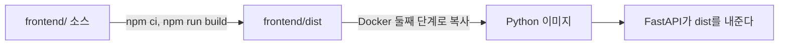

# 10. 프론트 구성 (React + Vite + TypeScript)

작성일: 2026-11-17 · 근거: [D-20, D-31, D-32](02-decisions.md) · 세부 규칙은 제안이다.

나중에 페이지를 나누거나 별도 화면이 생길 수 있다. 처음부터 그 여지를 두고, 보안과 의존성 관리를 운영 기준으로 맞춘다.

## 1. 원칙

| 원칙 | 내용 |
|---|---|
| 기능 단위로 나눈다 | 채팅, 벌집, 상태창을 각각 독립 폴더로 둔다. 한 기능을 고칠 때 다른 기능 폴더를 열 일이 없게 한다 |
| 의존 방향은 한쪽으로 | `features` → `shared`만 허용한다. `shared`가 `features`를 부르지 않고, 기능끼리 직접 부르지 않는다 |
| 의존성은 최소 | 실행에 필요한 패키지는 React뿐이다. 상태 관리, UI, 차트, 애니메이션 라이브러리를 넣지 않는다 |
| 서버만 믿는다 | 화면의 검사는 편의일 뿐이다. 모든 규칙은 서버가 다시 검사한다 |
| 비밀을 갖지 않는다 | 토큰, Colab 주소, 접속 키, 대화를 브라우저 저장소에 두지 않는다 |

## 2. 폴더 구조

```
frontend/
├── index.html
├── package.json / package-lock.json     버전 고정, lock 파일은 반드시 올린다
├── tsconfig.json                        strict
├── vite.config.ts                       개발 서버가 /api, /auth, /health 를 FastAPI로 넘긴다
└── src/
    ├── main.tsx                         시작점
    ├── app/                             앱 조립: 화면 배치, 경로, 전역 제공자
    │   ├── App.tsx
    │   └── routes.tsx                   "/" 본 화면, "/admin" 성능 화면
    ├── features/                        기능 단위 (서로 직접 부르지 않는다)
    │   ├── auth/                        시작 화면, 손님 시작, 구글 연결 묻기
    │   ├── chat/                        채팅창, 스트리밍, 행동 버튼
    │   ├── hive/                        벌집 좌표 계산, SVG, 벌 애니메이션, 리스트 보기
    │   ├── panel/                       상태창 구역들
    │   ├── voice/                       말하기
    │   └── admin/                       성능 검토 화면
    ├── shared/                          여러 기능이 함께 쓰는 것
    │   ├── api/                         서버 호출 한곳, API 타입, (개발용) 가짜 응답
    │   ├── state/                       함께 쓰는 상태 저장소
    │   ├── ui/                          버튼, 토글, 접기 같은 작은 부품
    │   └── i18n/                        화면 문구
    └── styles/                          테마 변수, 배치
```

### 페이지가 늘어날 때

| 상황 | 하는 일 |
|---|---|
| 새 화면 추가 (예: 일기 모아 보기) | `features/`에 폴더를 만들고 `app/routes.tsx`에 경로 한 줄을 더한다 |
| 화면이 커져 첫 로딩이 느려짐 | 경로 단위로 나눠 불러오기(`React.lazy`)를 적용한다. 관리자 화면부터 |
| 별도 사이트로 분리 (예: 관리자 전용) | `features/admin`과 `shared`를 그대로 들고 나간다. 의존 방향 규칙 덕분에 가능하다 |
| 경로가 많아짐 | 그때 라우터 라이브러리 도입을 검토한다. 지금은 작은 자체 라우터로 충분하다 |

## 3. 상태 관리

패널 세 개가 같은 상태를 본다. React 기본 기능(`useReducer` + Context)으로 작은 저장소를 만든다.

| 상태 | 어디에 | 새로고침하면 |
|---|---|---|
| 세션 (이름, 모드, 설정, 기능 토글) | 서버에서 받아 저장소에 | 서버에서 다시 받는다 |
| 태스크 | 서버가 원본, 저장소는 사본 | 서버에서 다시 받는다 |
| 대화 | 저장소(메모리)에만 | **사라진다** (D-08) |
| 후보, 등록 예정 | 저장소(메모리)에만 | 사라진다 |
| 패널 접힘, 테마 | 브라우저 저장소 | 남는다 |
| 기능 토글 | 서버(DB)에. 저장이 안 되면 브라우저 저장소 (D-28) | 남는다 |

상태를 바꾸는 길은 하나다: 화면 → 동작(action) → 저장소. 서버를 바꾸는 동작은 서버 응답이 성공한 뒤에 저장소를 바꾼다.

## 4. 서버 호출

- 모든 호출은 `shared/api/client.ts` 한곳을 지난다.
- 변경 요청에는 CSRF 헤더를 붙인다. 쿠키는 같은 사이트로만 보낸다.
- 오류는 서버가 주는 한국어 안내만 화면에 보여 준다. 내부 오류 내용은 보여 주지 않는다.
- 응답 모양은 `shared/api/types.ts`에 타입으로 적는다. 서버 계약이 바뀌면 빌드에서 잡힌다.
- 대화는 SSE로 받는다. 화면을 떠나면 받던 요청을 끊는다.

## 5. 보안

| 위험 | 대응 |
|---|---|
| XSS | React가 글자를 기본으로 이스케이프한다. `dangerouslySetInnerHTML`을 쓰지 않는다(검사 규칙으로 막는다). LLM의 답도 글자로만 넣는다 |
| 외부 스크립트 | CDN을 쓰지 않는다. 빌드한 파일만 내준다. CSP는 `script-src 'self'` |
| 인라인 스크립트·스타일 | 쓰지 않는다. 빌드 결과에 인라인 스크립트가 없는지 확인한다 |
| 비밀 노출 | `VITE_`로 시작하는 환경변수는 빌드 결과에 그대로 들어간다. 비밀값을 넣지 않는다 |
| 브라우저 저장소 | 화면 설정만 둔다 |
| 소스맵 | 운영 빌드에서는 내보내지 않는다 |
| 열린 리다이렉트 | 화면이 주소를 만들어 이동하지 않는다. 구글 시트 링크는 서버가 준 ID로 정해진 형식만 만든다 |
| 클릭재킹 | 서버의 `frame-ancestors 'none'` |

## 6. 의존성 관리 (공급망)

| 규칙 | 내용 |
|---|---|
| 버전 고정 | `package.json`에 정확한 버전을 적는다(`^`, `~` 없이) |
| lock 파일 | `package-lock.json`을 올리고 `npm ci`로만 설치한다 |
| 새 의존성 | 꼭 필요한 것만. 넣기 전에 유지 상태, 주간 다운로드, 설치 스크립트 유무를 본다 |
| 점검 | PR마다 `npm audit`, 주간 Dependabot |
| 설치 스크립트 | CI에서는 `--ignore-scripts`로 설치하는 것을 검토한다 |
| 부품 목록 | 빌드할 때 SBOM을 만든다 |
| Node 버전 | 정확한 LTS 버전을 고정한다(로컬은 24.22.1) |

실행 의존성은 `react`, `react-dom` 두 개를 목표로 한다. 나머지는 개발 도구다.

## 7. 품질 검사

| 검사 | 도구 | 언제 |
|---|---|---|
| 타입 | `tsc --noEmit` (`strict`) | PR |
| 문법·규칙 | ESLint (React 훅 규칙, 금지 API) | PR |
| 단위 테스트 | Vitest: 벌집 좌표 계산, D-day 계산, 저장소 동작 | PR |
| 화면 테스트 | Testing Library: 후보 담기 → 등록 예정 → 옮기기 | PR |
| 빌드 | `npm run build` | PR |
| 묶음 크기 | 빌드 결과 크기를 기록하고 크게 늘면 확인 | PR |

테스트는 기본 기능부터 만든다. 계산 로직(좌표, D-day) 테스트를 다 만든 뒤에는 코드를 일부러 망가뜨려 테스트가 잡는지 본다.

## 8. 접근성과 성능

- 벌집 칸은 버튼으로 만들어 키보드로 고를 수 있게 한다. 리스트 보기를 항상 제공한다.
- `prefers-reduced-motion`이면 벌 비행을 생략한다.
- 색만으로 상태를 구분하지 않는다(DONE 글자, 진행률 숫자).
- 애니메이션은 CSS `transform`과 `opacity`만 써서 구형 기기에서도 부드럽게 한다.
- 대화가 길어져도 느려지지 않게 최근 대화만 그린다.

## 9. 빌드와 배포



- 개발: Vite 개발 서버(화면) + FastAPI(API). Vite가 `/api`, `/auth`, `/health`를 FastAPI로 넘긴다.
- 운영: Docker 다단계 빌드(D-32). 화면과 API가 같은 주소라 CORS 설정이 필요 없다.
- `frontend/dist`는 Git에 올리지 않는다.

## 10. 아직 정하지 않은 것

| 내용 | 메모 |
|---|---|
| Render 무료에서 Docker 서비스가 되는지 | 확인하지 않았다 |
| 화면 테스트를 브라우저 자동화(E2E)까지 할지 | 3단계에서 정한다 |
| 다국어 문구 파일 형식 | 지금은 한국어 한 파일. 언어를 늘릴 때 정한다 |
