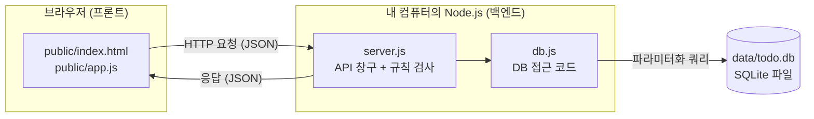
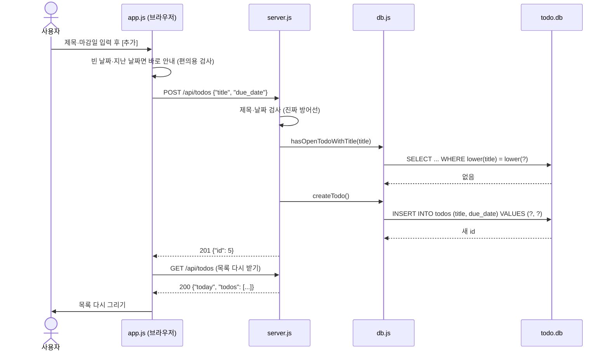

# 구조 (Architecture)

TODO 앱이 어떤 조각으로 이뤄져 있고, 요청 하나가 어떻게 흘러가는지 정리한 문서.

## 한눈에 보기

원칙은 하나다. **화면은 백엔드에만 말하고, 백엔드만 DB에 말한다.**
화면 코드(`public/`)는 누구나 브라우저에서 열어 볼 수 있으므로 DB 위치나 접속 정보를 절대 두지 않는다.

## 파일별 역할

| 파일 | 계층 | 하는 일 |
|---|---|---|
| `public/index.html` | 프론트 | 화면 뼈대: 위쪽 검색, 가운데 목록, 아래쪽 등록창 |
| `public/style.css` | 프론트 | 화면 꾸미기. 다크 모드 지원 |
| `public/app.js` | 프론트 | 버튼·입력 처리, 백엔드 API 호출, 목록 그리기, 확인창 |
| `public/demo-api.js` | 프론트(데모 전용) | GitHub Pages용 가짜 백엔드. [deployment.md](deployment.md) 참고 |
| `server.js` | 백엔드 | API 주소 정의, 입력값 검사, 규칙 검사, 에러 응답, 90일 자동 삭제 타이머 |
| `db.js` | 백엔드 | SQL은 전부 여기에. DB 연결, 표 생성, 조회·추가·수정·삭제 함수 |
| `db/schema.sql` | DB | 표·제약조건·색인 정의. 서버가 켜질 때마다 실행(이미 있으면 건너뜀) |
| `data/todo.db` | DB | 실제 데이터. 처음 실행 때 자동 생성, Git 제외 |
| `.env` | 설정 | 포트, DB 위치 같은 내 컴퓨터용 설정. Git 제외 ([.env.example](../.env.example)이 견본) |

### 왜 DB 코드를 `db.js` 하나에 모았나
길 B에서 저장소를 SQLite → Supabase(Postgres)로 바꿀 때 **이 파일의 함수 내용만 바꾸면** 되게 하려고.
`server.js`는 `db.createTodo()`처럼 함수 이름으로만 부르고, 그 안에서 SQLite를 쓰는지 Supabase를 쓰는지 모른다.

## 요청 하나의 흐름 - "할 일 추가"

- 화면의 검사는 **빠른 안내**용이고, 진짜 검사는 서버에서 다시 한다. 화면은 조작할 수 있기 때문이다([security.md](security.md)).
- 추가·수정·삭제 뒤에는 항상 목록을 서버에서 다시 받는다. 화면이 들고 있는 값과 DB가 어긋나지 않게 하려는 단순한 방식이다.

## 실행 흐름 - 서버가 켜질 때

1. `.env`가 있으면 읽는다(`node --env-file-if-exists=.env`).
2. `db.js`가 `data/` 폴더를 만들고 `todo.db`를 연다(없으면 새로 생성).
3. `db/schema.sql`을 실행한다. `IF NOT EXISTS`라서 이미 있는 표는 그대로 둔다.
4. 완료 후 90일 지난 할 일을 지운다. 이후 6시간마다 반복.
5. `public/` 폴더를 정적 파일로 내보내고, `/api/...` 요청을 받기 시작한다.

## 기술 선택

| 항목 | 선택 | 이유 |
|---|---|---|
| 런타임 | Node.js 24 | SQLite가 내장(`node:sqlite`)되어 따로 설치·빌드할 것이 없다 |
| 백엔드 | Express 5 | 가장 널리 쓰이고 자료가 많다. 의존성은 이것 하나 |
| DB | SQLite (파일 하나) | 길 A는 내 컴퓨터에서 완결. 서버 프로그램 설치가 필요 없다 |
| 프론트 | 순수 HTML/CSS/JS | 빌드 과정 없이 파일 그대로 열린다. 프레임워크 공부 없이 구조가 보인다 |

선택 이유를 더 자세히 적은 기록은 [decisions.md](decisions.md).
