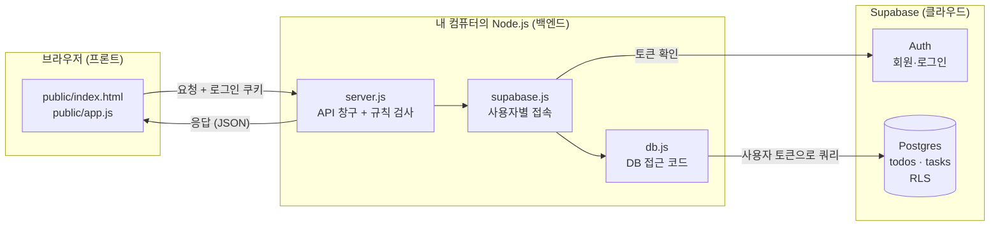
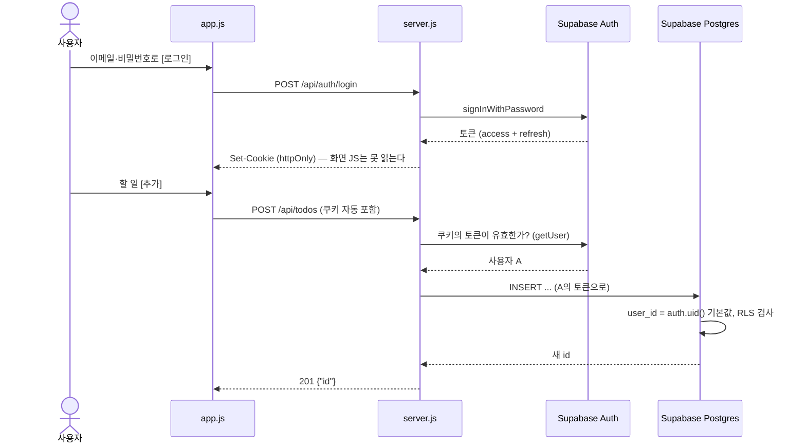

# 구조 (Architecture)

TODO 앱이 어떤 조각으로 이뤄져 있고, 요청 하나가 어떻게 흘러가는지 정리한 문서.
아래 그림은 **Supabase 모드(길 B)** 기준이다. `.env`에 Supabase 정보가 없으면 같은 서버가 **SQLite 모드(길 A)**로 돌고, 이때는 로그인 없이 `db/sqlite.js`가 `data/todo.db`를 쓴다.

## 한눈에 보기

원칙은 길 A와 같다. **화면은 백엔드에만 말하고, 백엔드만 DB에 말한다.**
화면 코드(`public/`)에는 Supabase 주소도 키도 없다. 키는 서버의 `.env`에만 있다.

## 파일별 역할

| 파일 | 계층 | 하는 일 |
|---|---|---|
| `public/index.html` | 프론트 | 화면 뼈대: 로그인 화면, 위쪽 검색, 가운데 목록, 아래쪽 등록창 |
| `public/style.css` | 프론트 | 화면 꾸미기. 다크 모드 지원 |
| `public/app.js` | 프론트 | 로그인 상태에 따라 화면 전환, 버튼·입력 처리, API 호출, 목록 그리기, 확인창 |
| `public/demo-api.js` | 프론트(데모 전용) | GitHub Pages용 가짜 백엔드. [deployment.md](deployment.md) 참고 |
| `server.js` | 백엔드 | API 주소 정의, 로그인 API, 로그인 확인, 입력값 검사, 에러 응답 |
| `supabase.js` | 백엔드 | 요청마다 "그 사용자로" Supabase에 접속하는 클라이언트를 만든다. 로그인 쿠키를 읽고 쓴다 |
| `db.js` | 백엔드 | DB 입구. `.env`에 Supabase 정보가 있으면 `db/supabase.js`, 없으면 `db/sqlite.js`를 쓴다 |
| `db/supabase.js` | 백엔드 | Supabase 모드 DB 쿼리. 모든 함수가 사용자의 클라이언트를 받는다 |
| `db/sqlite.js` | 백엔드 | SQLite 모드 DB 쿼리(`data/todo.db`, 로그인 없음). 함수 이름·인자는 supabase.js와 같다 |
| `db/schema.sql` | DB | SQLite 모드의 표 정의. 서버가 켜질 때 자동 실행 |
| `db/supabase/01_schema.sql` | DB | 표·제약조건·색인·RLS 정책·규칙 함수 정의. Supabase SQL Editor에서 한 번 실행 |
| `db/supabase/02_cron.sql` | DB | (선택) 90일 지난 완료 항목 매일 삭제 |
| `scripts/rls-check.mjs` | 확인 | 계정 두 개로 RLS가 막는지 자동 확인 (`npm run check:rls`) |
| `.env` | 설정 | Supabase 주소와 공개 키, 포트. Git 제외 ([.env.example](../.env.example)이 견본) |

### 왜 DB 코드를 `db.js` 하나에 모았나
길 A → B 전환 때 실제로 `db.js`의 함수 내용만 바꾸고 `server.js`의 API 주소와 규칙은 거의 그대로 썼다.
바뀐 것은 함수가 첫 번째 인자로 "사용자의 Supabase 클라이언트"를 받게 된 것 정도다.

## 로그인과 RLS가 맞물리는 방식

- **비밀번호**는 서버를 지나 Supabase Auth로만 간다. 우리 DB에도, 로그에도 남지 않는다. Supabase가 해시로 저장한다.
- **토큰**은 httpOnly 쿠키에 있다. 화면의 자바스크립트가 읽을 수 없어서, 악성 스크립트가 들어와도 토큰을 훔치기 어렵다.
- **토큰 갱신**: access 토큰은 1시간 정도면 만료된다. `@supabase/ssr`이 요청 때 refresh 토큰으로 새로 받아 쿠키를 바꿔 준다.
- **RLS**: 서버가 사용자의 토큰으로 DB를 부르므로, Postgres가 `auth.uid()`로 사용자를 알고 그 사람의 행만 허락한다. 서버 코드에 실수가 있어도 남의 행은 건드릴 수 없다.

## 요청 하나의 흐름 - "할 일 추가"

1. `app.js`: 빈 날짜·지난 날짜면 바로 안내 (편의용 검사)
2. `server.js` `requireUser`: 쿠키의 토큰으로 사용자 확인. 없으면 401 → 화면이 로그인 화면으로
3. `server.js`: 제목·날짜 검사 (진짜 방어선)
4. `db.js` `createTodo`: `insert({ title, due_date })` — `user_id`는 DB가 채운다
5. Postgres: RLS 검사, 중복 제목이면 UNIQUE 색인이 거절(23505) → 서버가 409로 바꿔 응답
6. `app.js`: 목록을 다시 받아 그린다

## 실행 흐름 - 서버가 켜질 때

1. `.env`를 읽는다(`node --env-file-if-exists=.env`).
2. `SUPABASE_URL`과 키가 둘 다 있으면 Supabase 모드, 둘 다 없으면 SQLite 모드(로그인 없음, `data/todo.db`). 하나만 있으면 안내를 출력하고 종료.
3. `public/` 폴더를 정적 파일로 내보내고 `/api/...` 요청을 받기 시작한다.
4. DB 연결을 미리 열어 두지 않는다. 요청이 올 때마다 그 사용자로 접속한다.

## 기술 선택

| 항목 | 선택 | 이유 |
|---|---|---|
| 런타임 | Node.js 24 | 길 A부터 사용. `fetch`, `--env-file` 내장 |
| 백엔드 | Express 5 | 가장 널리 쓰이고 자료가 많다. async 에러를 자동으로 에러 처리기로 넘긴다 |
| DB | Supabase (Postgres) | 무료, 강의 길 B 지정. 로그인(Auth)과 RLS가 함께 있다 |
| 로그인 | Supabase Auth | 직접 만들지 않는다(강의 원칙). 비밀번호 해시·토큰 관리는 검증된 도구에 |
| 서버용 클라이언트 | `@supabase/ssr` | 토큰을 쿠키로 주고받고 자동 갱신하는 공식 라이브러리 |
| 프론트 | 순수 HTML/CSS/JS | 빌드 과정 없이 파일 그대로 열린다 |

선택 이유를 더 자세히 적은 기록은 [decisions.md](decisions.md).
