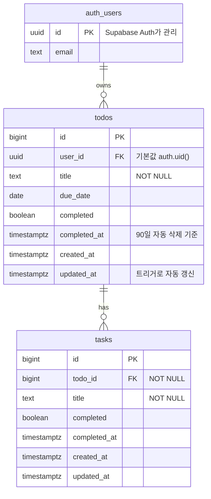

# 데이터베이스

실제 정의는 [db/supabase/01_schema.sql](../db/supabase/01_schema.sql)이 정답이다. 이 문서는 그 내용을 사람이 읽기 쉽게 풀어 쓴 것.
SQL 파일을 바꾸면 이 문서도 함께 고친다.

지금은 **Supabase (Postgres)**. 길 A의 SQLite 버전은 `path-a` 태그의 `db/schema.sql`과 이 문서에 있다.

## 구조도

표 2개, **todos 1 : N tasks** (일대다). 할 일마다 주인(`user_id`)이 있고, 사용자는 Supabase Auth가 관리한다.



### 왜 표를 2개로 나눴나
- 할 일 하나에 태스크가 여러 개 붙는다 → 전형적인 **1:N**. 태스크 표에 "어느 할 일의 것인지"(`todo_id`) 칸 하나만 두면 된다.
- 한 표에 `parent_id`를 두면 "태스크 아래 태스크"도 만들어질 수 있다. 표를 나누면 **한 단계만**이 구조로 보장된다.

### 왜 tasks에는 user_id가 없나
태스크의 주인은 "속한 할 일의 주인"으로 정해진다. 같은 정보를 두 곳에 적지 않는다(정규화).
RLS 정책도 "내 할 일에 속한 태스크만"으로 할 일 표를 거쳐 확인한다.

## todos - 큰 할 일

| 열 | 타입 | 설명 |
|---|---|---|
| `id` | bigint, 자동 증가 | 번호 |
| `user_id` | uuid NOT NULL → `auth.users.id` | 주인. **넣지 않아도 DB가 로그인한 사용자(`auth.uid()`)로 채운다.** 사용자가 탈퇴하면 함께 삭제 |
| `title` | text NOT NULL | 제목. 빈 글자 금지 |
| `due_date` | date | 마감일. 새로 등록할 때는 필수이고 오늘 이후만 가능(백엔드 검사) |
| `completed` | boolean | 완료 여부 |
| `completed_at` | timestamptz | 완료한 시각. 미완료면 NULL. **이 시각부터 90일 뒤 자동 삭제** |
| `created_at` | timestamptz | 만든 시각 |
| `updated_at` | timestamptz | 마지막으로 바꾼 시각. 트리거가 자동으로 바꾼다 |

## tasks - 하위 태스크

| 열 | 타입 | 설명 |
|---|---|---|
| `id` | bigint, 자동 증가 | 번호 |
| `todo_id` | bigint NOT NULL → `todos.id` | 어느 할 일에 속하는지. **할 일 없는 태스크는 만들 수 없다** |
| `title` | text NOT NULL | 제목 |
| `completed` | boolean | 완료 여부 |
| `completed_at` | timestamptz | 완료한 시각 |
| `created_at` | timestamptz | 만든 시각 |
| `updated_at` | timestamptz | 마지막으로 바꾼 시각(트리거) |

## 제약조건 - DB가 직접 막는 것

| 제약 | 막는 것 |
|---|---|
| `title NOT NULL CHECK (length(trim(title)) > 0)` | 빈 제목, 공백만 있는 제목 |
| `CHECK (completed = (completed_at IS NOT NULL))` | "완료인데 완료 시각이 없음" 같은 앞뒤가 안 맞는 상태 |
| `todo_id NOT NULL REFERENCES todos ON DELETE CASCADE` | 없는 할 일에 붙은 태스크. 할 일을 지우면 태스크도 함께 |
| `user_id REFERENCES auth.users ON DELETE CASCADE` | 없는 사용자의 할 일. 탈퇴하면 할 일도 함께 |
| UNIQUE `todos (user_id, lower(title)) WHERE NOT completed` | **같은 사람의 미완료 할 일끼리 같은 제목** (대소문자 무시) |
| UNIQUE `tasks (todo_id, lower(title))` | **같은 할 일 안의 태스크끼리 같은 제목** |

길 A에서는 중복 금지를 서버 코드로만 막았다. 길 B는 새 DB라 기존 데이터와 충돌할 걱정이 없어 **DB 색인으로 막는다.** 동시에 두 번 눌러도 하나만 들어간다.
DB가 아니라 백엔드가 지키는 규칙(마감일 필수, 지난 날짜 금지 등)은 [business-rules.md](business-rules.md).

## RLS (행 수준 보안)

로그인한 사용자(`authenticated` 역할)에게만, 그리고 **자기 행만** 허락한다.

| 표 | 정책 | 조건 |
|---|---|---|
| `todos` | `todos: own rows` (조회·추가·수정·삭제) | `auth.uid() = user_id` |
| `tasks` | `tasks: rows of own todos` (조회·추가·수정·삭제) | 속한 할 일의 `user_id = auth.uid()` |

- `using`: 어떤 행을 **보고·고치고·지울 수 있나**. 남의 행은 아예 안 보인다(에러가 아니라 0행).
- `with check`: 어떤 행을 **만들거나 바꾼 결과로 둘 수 있나**. 남의 `user_id`로 넣거나, 남의 할 일에 태스크를 넣으면 에러.
- 로그인하지 않은 사용자(`anon`)는 두 표에 대한 권한 자체를 뺐다(`revoke all`).
- `auth.uid()`를 `(select auth.uid())`로 감싼 것은 행마다 함수를 다시 부르지 않게 하는 Supabase 권장 방식이다.

## 규칙 함수

여러 행을 "전부 되거나, 전부 안 되거나"로 바꿔야 하는 작업은 DB 함수로 만들었다. 함수 하나가 하나의 트랜잭션이다.
`security invoker`(기본값)라서 부른 사용자의 RLS가 그대로 적용된다. 남의 할 일 id를 넣으면 0행이 바뀐다.

| 함수 | 하는 일 |
|---|---|
| `set_todo_completed(p_todo_id, p_completed)` | 완료: 할 일과 **남은 태스크까지** 완료. 미완료: 할 일만 미완료 |
| `set_task_completed(p_task_id, p_completed)` | 완료: 태스크만. 미완료: 태스크와, 완료돼 있던 **할 일도 미완료로** |
| `set_updated_at()` | 트리거 함수. 행이 바뀔 때 `updated_at = now()` |

되돌리다가 중복 제목에 걸리면(UNIQUE 위반) 함수 전체가 취소되어 태스크도 그대로 남는다.

## 색인 (Index)

| 색인 | 어떤 화면/작업 때문에 |
|---|---|
| `tasks_todo_title_unique` (`todo_id, lower(title)`) | 중복 금지 + 할 일마다 태스크 불러오기 (앞 칸이 `todo_id`라 겸용) |
| `todos_open_title_unique` (`user_id, lower(title)`, 미완료만) | 중복 금지 |
| `todos_user_due_date` (`user_id, due_date`) | "오늘 할 일만" 보기 |
| `todos_completed_at` (`completed_at`) | 90일 자동 삭제 |

## 화면 기능 ↔ 쿼리

`db/supabase.js`는 SQL 문자열 대신 Supabase 클라이언트의 메서드로 쿼리를 만든다. 값은 언제나 따로 전달된다(SQL 주입 불가).

| 화면 기능 | `db/supabase.js` (Supabase 클라이언트) | 실제로 실행되는 SQL (요약) |
|---|---|---|
| 목록 + 태스크 | `from('todos').select('..., tasks (...)')` | `SELECT ... FROM todos` + 각 할 일의 `tasks` (RLS로 내 것만) |
| 오늘 할 일만 | `.eq('due_date', today)` | `WHERE due_date = $1` |
| 정렬 | `.order('completed').order('due_date', { nullsFirst: false }).order('id', { ascending: false })` | `ORDER BY completed, due_date NULLS LAST, id DESC` |
| 검색 | 내 목록을 받아 서버에서 제목·태스크 제목으로 거름 | — |
| 할 일 추가 | `from('todos').insert({ title, due_date })` | `INSERT INTO todos (title, due_date) VALUES ($1, $2)` |
| 태스크 추가 | `from('tasks').insert({ todo_id, title })` | `INSERT INTO tasks ...` |
| 완료 처리 | `rpc('set_todo_completed', {...})` | 함수 안에서 `UPDATE todos ...; UPDATE tasks ...` |
| 삭제 | `from('todos').delete().eq('id', id)` | `DELETE FROM todos WHERE id = $1` (태스크는 CASCADE) |
| 90일 정리 | `delete().eq('completed', true).lte('completed_at', cutoff)` | `DELETE FROM todos WHERE completed AND completed_at <= $1` |

검색을 서버에서 거르는 이유: "할 일 제목 **또는** 그 태스크 제목"을 한 번에 거는 조건이 Supabase 클라이언트로는 복잡해진다. 어차피 RLS로 자기 할 일만 받아 오므로 개인 할 일 규모에서는 충분하다.

### 회고용: `SELECT … FROM … WHERE …`를 내 데이터로 풀어 읽기
```sql
SELECT title, due_date FROM todos WHERE completed = false AND due_date = current_date;
```
"할 일 표에서(`FROM todos`) 아직 안 끝났고 마감일이 오늘인 것들의(`WHERE`) 제목과 마감일을 줘(`SELECT`)."
Supabase SQL Editor에서 실행하면 관리자 권한이라 **모든 사용자의 행**이 나온다. 앱에서는 RLS 때문에 내 것만 보인다.

## 길 A(SQLite)와 달라진 점

| | 길 A (SQLite) | 길 B (Postgres) |
|---|---|---|
| 번호 | INTEGER AUTOINCREMENT | bigint identity |
| 날짜·시각 | TEXT (`YYYY-MM-DD`, UTC 문자열) | `date`, `timestamptz` |
| 참거짓 | INTEGER 0/1 | boolean |
| 주인 | 없음 (혼자 쓰는 앱) | `user_id` + RLS |
| 중복 금지 | 서버 코드 | DB UNIQUE 색인 (+ 서버가 409로 안내) |
| 완료 묶음 처리 | `BEGIN ... COMMIT` | DB 함수 (`rpc`) |
| updated_at | 쿼리마다 직접 | 트리거 |
| 90일 삭제 | 서버 타이머 | 목록 조회 때 사용자별 + (선택) pg_cron |
| 외래키 | `PRAGMA foreign_keys = ON` 필요 | 항상 켜져 있음 |

## DB 직접 보기

- Supabase 대시보드 **Table Editor**: 행을 표로 본다. 관리자 권한이라 RLS와 상관없이 모두 보인다.
- **SQL Editor**: 위의 SELECT 같은 쿼리를 직접 실행.
- 대시보드에서 값을 고치면 앱의 규칙(서버 검사)을 거치지 않는다. 확인 용도로만 쓴다.

백업과 복구는 [operations.md](operations.md#백업과-복구).
