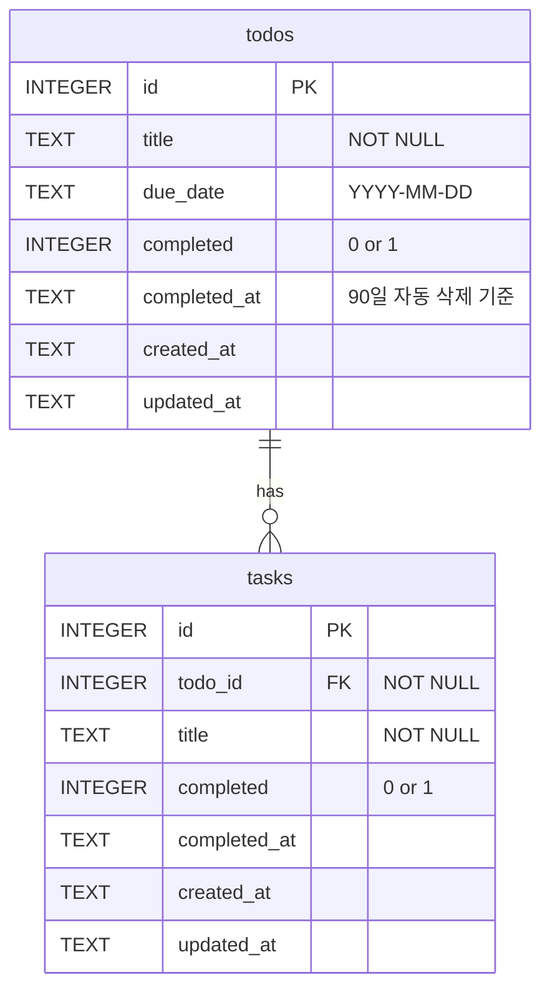

# 데이터베이스

실제 정의는 [db/schema.sql](../db/schema.sql)이 정답이다. 이 문서는 그 내용을 사람이 읽기 쉽게 풀어 쓴 것.
`schema.sql`을 바꾸면 이 문서도 함께 고친다.

## 구조도

표 2개, **todos 1 : N tasks** (일대다).



### 왜 표를 2개로 나눴나
- 할 일 하나에 태스크가 여러 개 붙는다 → 전형적인 **1:N**. 태스크 표에 "어느 할 일의 것인지"(`todo_id`) 칸 하나만 두면 된다.
- 태스크를 할 일 표 한 칸에 "자료 찾기, 초안 쓰기"처럼 몰아 적으면 검색·완료 체크가 깨진다.
- 한 표(`todos`)에 `parent_id`를 두는 방법도 있지만, 그러면 "태스크 아래 태스크"도 만들어질 수 있다. 표를 나누면 **한 단계만**이 구조로 보장된다.

## todos - 큰 할 일

| 열 | 타입 | 설명 |
|---|---|---|
| `id` | INTEGER PK | 자동 증가 번호 |
| `title` | TEXT NOT NULL | 할 일 제목. 빈 글자 금지 |
| `due_date` | TEXT | 마감일 `YYYY-MM-DD`. 새로 등록할 때는 필수이고 오늘 이후만 가능(백엔드 검사) |
| `completed` | INTEGER | 0 = 미완료, 1 = 완료 |
| `completed_at` | TEXT | 완료한 시각(UTC). 미완료면 NULL. **이 시각부터 90일 뒤 자동 삭제** |
| `created_at` | TEXT | 만든 시각(UTC) |
| `updated_at` | TEXT | 마지막으로 바꾼 시각(UTC) |

## tasks - 하위 태스크

| 열 | 타입 | 설명 |
|---|---|---|
| `id` | INTEGER PK | 자동 증가 번호 |
| `todo_id` | INTEGER NOT NULL FK → `todos.id` | 어느 할 일에 속하는지. **NOT NULL이라 할 일 없는 태스크는 만들 수 없다** |
| `title` | TEXT NOT NULL | 태스크 제목 |
| `completed` | INTEGER | 0 = 미완료, 1 = 완료 |
| `completed_at` | TEXT | 완료한 시각(UTC) |
| `created_at` | TEXT | 만든 시각(UTC) |
| `updated_at` | TEXT | 마지막으로 바꾼 시각(UTC) |

## 제약조건 - DB가 직접 막는 것

화면이나 서버 코드에 실수가 있어도 DB가 마지막으로 막아 준다.

| 제약 | 막는 것 |
|---|---|
| `title NOT NULL CHECK (length(trim(title)) > 0)` | 빈 제목, 공백만 있는 제목 |
| `due_date ... GLOB '[0-9][0-9][0-9][0-9]-...'` | `10/29` 같은 다른 형식의 날짜 |
| `completed IN (0, 1)` | 0, 1 이외의 값 |
| `CHECK ((completed = 1) = (completed_at IS NOT NULL))` | "완료인데 완료 시각이 없음" 같은 앞뒤가 안 맞는 상태 |
| `todo_id NOT NULL REFERENCES todos(id)` | 없는 할 일에 붙은 태스크 |
| `ON DELETE CASCADE` | 할 일을 지우면 그 태스크가 고아로 남는 것 (함께 지운다) |

DB가 아니라 **백엔드가** 지키는 규칙(마감일 필수, 지난 날짜 금지, 중복 제목 금지 등)은 [business-rules.md](business-rules.md)에 따로 정리했다.

## 색인 (Index)

자주 찾는 조건에만 걸었다. 색인은 찾기를 빠르게 하지만 넣고 고칠 때 조금 느려지고 공간도 든다.

| 색인 | 어떤 화면/작업 때문에 |
|---|---|
| `idx_tasks_todo_id` (`tasks.todo_id`) | 할 일마다 태스크 목록 불러오기 |
| `idx_todos_due_date` (`todos.due_date`) | "오늘 할 일만" 보기 |
| `idx_todos_completed_at` (`todos.completed_at`) | 90일 지난 완료 항목 자동 삭제 |

## 화면 기능 ↔ SQL

앱이 실제로 쓰는 SQL을 화면 기능별로 정리했다. `?` 자리에는 사용자가 입력한 값이 **따로** 전달된다(파라미터화 쿼리).

| 화면 기능 | SQL (요약) |
|---|---|
| 목록 보기 | `SELECT * FROM todos ORDER BY completed, due_date IS NULL, due_date, id DESC` |
| 태스크 함께 보기 | `SELECT * FROM tasks WHERE todo_id IN (?, ?, ...) ORDER BY id` |
| 검색 | `... WHERE title LIKE ? ESCAPE '\' OR EXISTS (SELECT 1 FROM tasks s WHERE s.todo_id = t.id AND s.title LIKE ? ESCAPE '\')` |
| 오늘 할 일만 | `... WHERE due_date = ?` (서버 컴퓨터 기준 오늘 날짜) |
| 할 일 추가 | `INSERT INTO todos (title, due_date) VALUES (?, ?)` |
| 태스크 추가 | `INSERT INTO tasks (todo_id, title) VALUES (?, ?)` |
| 중복 확인 | `SELECT 1 FROM todos WHERE completed = 0 AND lower(title) = lower(?) AND id <> ?` |
| 완료 처리 | `UPDATE todos SET completed = 1, completed_at = datetime('now') ... WHERE id = ?` (트랜잭션으로 태스크와 함께) |
| 삭제 | `DELETE FROM todos WHERE id = ?` (태스크는 CASCADE로 함께) |
| 90일 자동 삭제 | `DELETE FROM todos WHERE completed = 1 AND completed_at <= datetime('now', '-90 days')` |

### 회고용: `SELECT … FROM … WHERE …`를 내 데이터로 풀어 읽기
```sql
SELECT title, due_date FROM todos WHERE completed = 0 AND due_date = '2026-11-05';
```
"할 일 표에서(`FROM todos`) 아직 안 끝났고 마감일이 11월 5일인 것들의(`WHERE`) 제목과 마감일을 줘(`SELECT`)."

## SQLite에서 신경 쓴 점

- **날짜 타입이 없다.** 날짜·시각을 글자(TEXT)로 저장한다. `YYYY-MM-DD` 형식이면 글자 순서로 정렬해도 날짜 순서와 같다.
- **참/거짓 타입이 없다.** `completed`를 0/1로 저장하고, API로 내보낼 때 `true`/`false`로 바꾼다.
- **외래키 검사가 기본으로 꺼져 있다.** `schema.sql` 맨 위의 `PRAGMA foreign_keys = ON`으로 연결할 때마다 켠다.
- **시각은 UTC로 저장한다.** 한국 시간과 9시간 차이가 나지만, 90일 계산처럼 "얼마나 지났나"만 보는 데는 문제가 없다. 마감일(`due_date`)은 시각이 아니라 날짜라서 서버 컴퓨터의 현지 날짜로 비교한다.
- **LIKE는 영문 대소문자를 무시한다.** 검색에서 `Report`와 `report`가 같이 찾아진다. `%`, `_`는 글자 그대로 찾도록 이스케이프한다.

## DB 파일 직접 열어 보기

- VS Code: "SQLite Viewer" 확장 설치 → `data/todo.db` 클릭
- 따로 프로그램: [DB Browser for SQLite](https://sqlitebrowser.org/) (무료)
- 서버가 켜져 있을 때 뷰어로 **값을 고치지는 않는다.** 읽기만 한다.

백업과 복구는 [operations.md](operations.md#백업과-복구).

## 길 B(Supabase)에서 바뀔 것

| 바뀌는 점 | 이유 |
|---|---|
| `todos.user_id uuid NOT NULL REFERENCES auth.users(id)` 열 추가 | 할 일마다 주인을 기록 |
| RLS 켜기 + "자기 `user_id`인 행만" 정책 | 다른 사람 할 일을 보거나 고칠 수 없게 |
| `INTEGER` → `bigint generated always as identity`, `0/1` → `boolean`, `TEXT` 날짜 → `date` / `timestamptz` | Postgres에는 진짜 날짜·참거짓 타입이 있다 |
| 중복 제목 규칙에 `user_id` 포함 | 다른 사람과는 같은 제목이어도 된다 |

자세한 계획은 [roadmap.md](roadmap.md).
