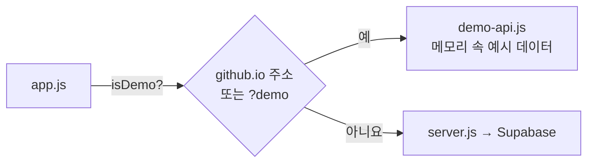

# 배포

## 지금 상태

| 무엇 | 어디 | 데이터 |
|---|---|---|
| 진짜 앱 | 내 컴퓨터 (`npm start`) | Supabase(클라우드 Postgres)에 저장, 로그인한 사람마다 따로 |
| 데모 화면 | https://eple-lab.github.io/task-hive/ | 브라우저 메모리. 새로고침하면 예시 데이터로 초기화 |
| 코드 | https://github.com/eple-lab/task-hive | |

## GitHub Pages 데모

### 왜 진짜 앱을 Pages에 못 올리나
GitHub Pages는 HTML·CSS·JS 파일을 그대로 보여 주기만 하는 **정적 호스팅**이다. `server.js`를 실행하지 않으므로 API도 DB도 없다.
그냥 올리면 화면 틀만 나오고 "목록을 불러오지 못했습니다"가 뜬다.

### 데모 모드
`public/demo-api.js`가 브라우저 안에서 서버 역할을 대신한다.

- 주소가 `github.io`로 끝나거나 `?demo`가 붙으면 `app.js`의 API 호출이 `demo-api.js`로 간다.
- `demo-api.js`는 `server.js`와 **같은 주소, 같은 규칙, 같은 응답 모양**으로 답한다. 그래서 `app.js`는 데모인지 모르고 똑같이 동작한다.
- 예시 데이터의 마감일은 방문한 날을 기준으로 만든다(언제 열어도 "오늘 마감"이 있다).
- 화면 위에 "데모 화면이에요…" 안내가 뜬다.
- 내 컴퓨터에서 데모 모드를 보려면: http://localhost:3000/?demo

> 규칙을 바꿀 때는 `server.js`와 `demo-api.js`를 **둘 다** 고쳐야 한다. 한쪽만 고치면 데모와 진짜 앱이 다르게 동작한다.

### 자동 배포
[.github/workflows/pages.yml](../.github/workflows/pages.yml)

- `main`에 push했을 때 `public/` 또는 이 설정 파일이 바뀌었으면 GitHub Actions가 `public/` 폴더를 Pages에 올린다.
- 진행 상황: 저장소의 **Actions** 탭. 1분 안팎이면 끝난다.
- 수동 실행: Actions → "Deploy demo to GitHub Pages" → Run workflow.
- 저장소 Settings → Pages의 Source는 **GitHub Actions**로 설정되어 있다.

## 길 C: 진짜 앱을 인터넷에 올리려면 (준비물 노트)

강의 필수 과제는 "배포 준비물을 안내받아 기록"하는 것까지이고, 실제 배포는 선택이다.

### 왜 길 B가 먼저인가
Render 같은 무료 서버는 재시작·재배포할 때 디스크를 초기화하는 경우가 많다. 길 A의 `todo.db`였다면 통째로 사라진다.
길 B에서 데이터가 Supabase로 옮겨 갔으므로, 서버는 언제 다시 켜져도 상관없다. **서버에는 데이터가 없고 Supabase에만 있다.**

### Render에 백엔드를 올릴 때 필요한 것
| 준비물 | 이 프로젝트에서 |
|---|---|
| 코드 보관 위치 | GitHub 저장소 `eple-lab/task-hive` (`main` 브랜치) |
| 서비스 종류 | Web Service (Node) |
| 리전 | Singapore (Supabase 서울과 가까운 곳) |
| 설치 명령 (Build Command) | `npm install` |
| 시작 명령 (Start Command) | `npm start` |
| Node 버전 | 24 이상. `package.json`의 `engines`를 Render가 읽는다. 안 되면 환경변수 `NODE_VERSION=24` |
| 환경변수 | `SUPABASE_URL`, `SUPABASE_PUBLISHABLE_KEY`, `NODE_ENV=production`. **Render 대시보드의 Environment 화면에 입력**하고 코드·Git에는 넣지 않는다 |
| 포트 | Render가 `PORT` 환경변수를 넣어 준다. `server.js`가 이미 `process.env.PORT`를 읽는다 |
| https | Render가 자동으로 붙여 준다. `NODE_ENV=production`이면 로그인 쿠키가 https로만 전송된다 |
| Supabase 쪽 설정 | Authentication → URL Configuration의 **Site URL**을 Render 주소로 (이메일 인증 링크가 그 주소로 돌아오게) |
| 확인 방법 | 배포 후 받은 `https://….onrender.com` 접속 → 회원가입·로그인 → 할 일 추가 → 새로고침 → Supabase Table Editor에서 행 확인 |

### 배포에 도전한다면 순서
1. Render 가입 → New → Web Service → GitHub 저장소 연결
2. 위 표대로 명령과 환경변수 입력 → Create
3. 로그(Logs)에 `Task Hive: http://localhost:10000` 같은 줄이 나오면 서버가 켜진 것 (주소는 Render가 바꿔 보여 준다)
4. 받은 주소로 접속해 확인. 성공하면 주소를 [verification.md](verification.md)와 과제 제출에 남긴다

### 알아 둘 점
- Render 무료 서버는 한동안 요청이 없으면 잠들고, 다음 접속 때 깨어나느라 첫 응답이 느리다.
- Supabase 무료 프로젝트는 1주일 동안 안 쓰면 일시정지된다. 시연 전에 미리 접속해 둔다.
- 무료 요금제 한도와 정책은 바뀔 수 있으니 가입 직전에 공식 가격 페이지를 확인한다.
