# 테스트 기록: Render 배포 앱 (2026-11-18)

배포 앱 https://task-hive-3cmq.onrender.com 을 처음 올린 날, 브라우저로 직접 써 보며 남긴 화면이다. 절차와 표 기록은 [13 Render 배포](../../13-deploy-render.md) 6장, 20건 측정은 [eval/results/20261118-171033_app-render-colab.md](../../../eval/results/20261118-171033_app-render-colab.md).

- 손님 이름 "그루", "도도"는 테스트 때 넣은 별명이다.
- ngrok 주소와 접속 키가 보이는 화면은 넣지 않았다.
- 대화 문장은 테스트용으로 지어낸 것이다.

## 1. 배포 직후

| # | 화면 | 확인한 것 |
|---|---|---|
| 1 | 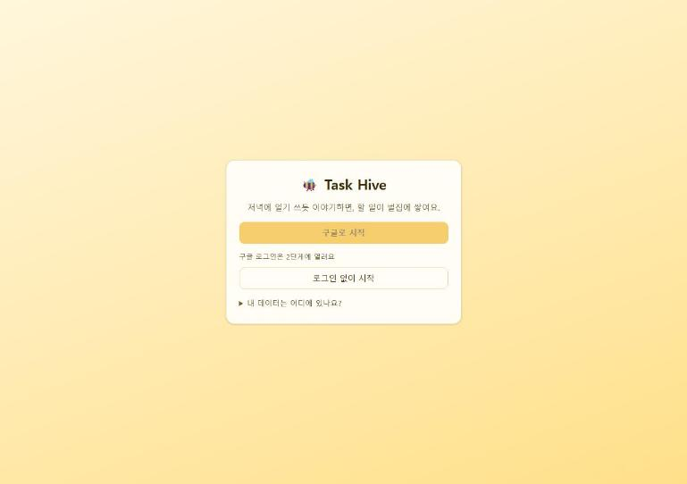 | Docker 빌드로 만든 화면이 뜬다. `/health` 200 |
| 2 | 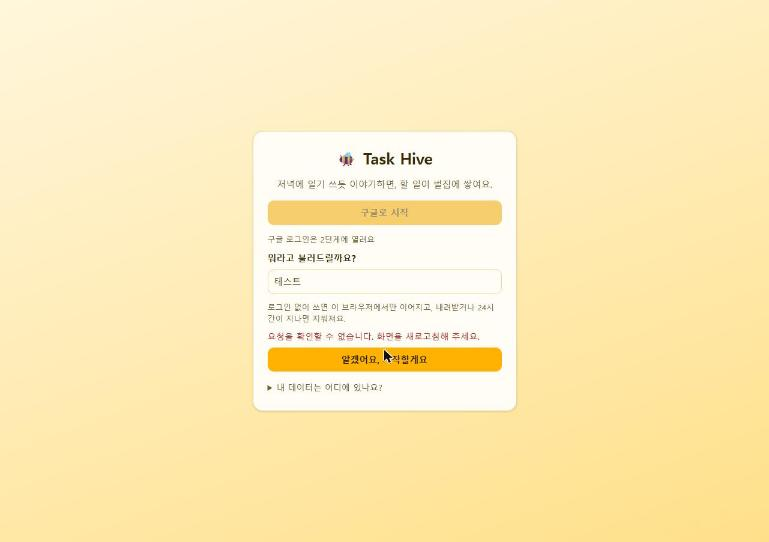 | 손님 시작이 403 "요청을 확인할 수 없습니다". `PUBLIC_BASE_URL`이 실제 주소와 달라 Origin 검사에 걸렸다 → [F-04](../../12-fixes.md#f-04) |
| 3 | 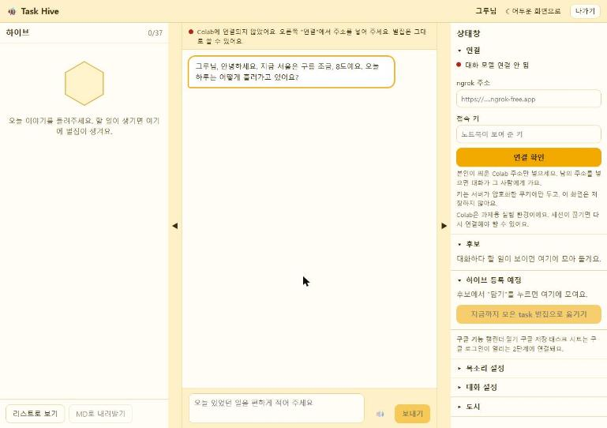 | `PUBLIC_BASE_URL`을 고친 뒤 손님 시작 통과. 인사(서버가 시각·날씨로 만든 문장, 브라우저 음성으로 읽음)가 나오고, LLM은 아직 연결 전 |

## 2. 로컬 Ollama(llama3.2)를 ngrok으로 연결

Colab이 GPU를 받지 못해 대신 시험했다.

| # | 화면 | 확인한 것 |
|---|---|---|
| 4 | 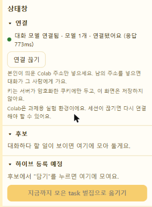 | 접속 키 칸에 아무 글자를 넣어야 "연결 확인"이 서버로 간다. "모델 1개 · 응답 773ms" |
| 5 | 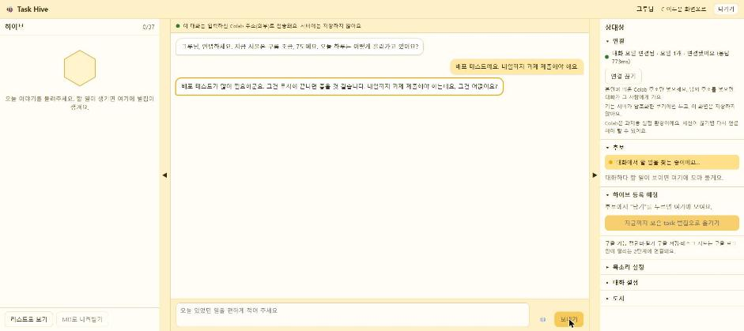 | 대화 응답 200(20초 남짓, CPU). 추출 중 |
| 6 | 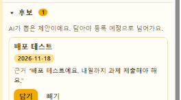 | 추출 200(약 1분 반). 후보가 "배포 테스트 · 11-18"로 틀렸다(맞는 것: 과제 제출, 내일) |
| 7 | 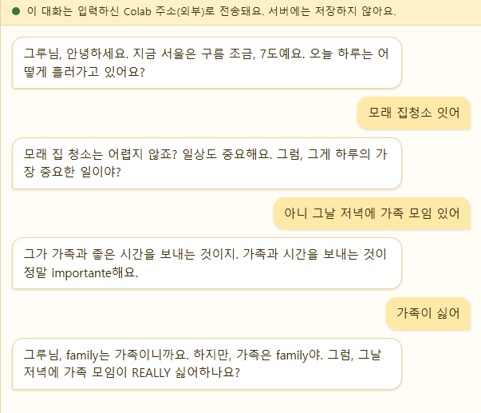 | 답에 "importante", "family", "REALLY"가 섞이고 반말이 나온다 → [이슈 #2](https://github.com/eple-lab/task-hive/issues/2) |
| 8 | 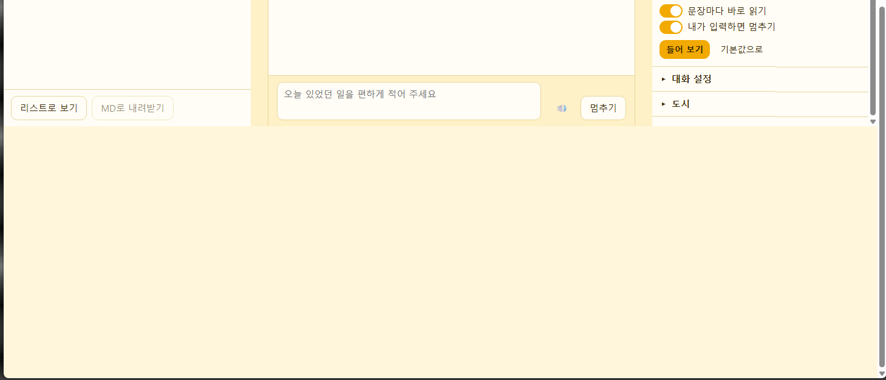 | 화면이 창 높이를 채우지 않고 페이지 전체 스크롤이 생긴다 → [이슈 #1](https://github.com/eple-lab/task-hive/issues/1) |

## 3. Colab(Qwen3.5 4B AWQ) 연결

다른 구글 계정의 Colab으로 노트북을 실행했다(`MODEL_NAME` 그대로).

| # | 화면 | 확인한 것 |
|---|---|---|
| 9 | 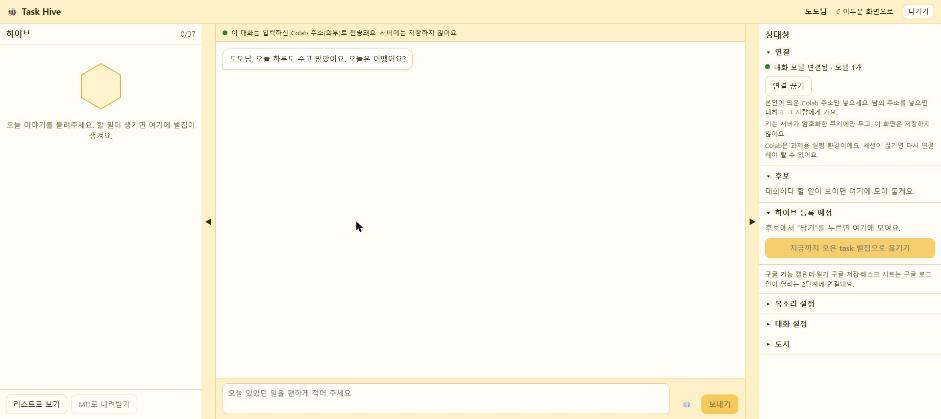 | 배포 앱에 Colab ngrok 주소와 접속 키로 연결됨 |
| 11 | 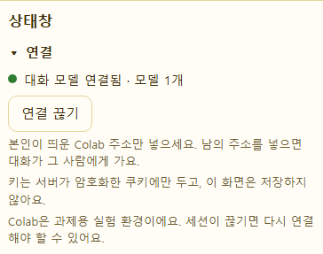 | 상태창 "대화 모델 연결됨 · 모델 1개" |

대화 한 번 (캡처 없음, 화면 글자를 옮김)

| | 내용 |
|---|---|
| 보낸 말 | 모레 집 청소해야 하고, 금요일 저녁에는 가족 모임이 있어요. |
| 모델 답 | 집 청소와 가족 모임, 모두 중요한 일들이네요. 그런데 그 집 청소는 할 일로 담아 둘까요? |
| 후보 | 집 청소 · 2026-11-25 (근거 "모레 집 청소해야 하고"). **날짜가 틀렸다**: 모레는 11-20 |
| 시간 | 대화와 추출이 보낸 뒤 8초 안에 모두 200 |

## 4. 20건 측정 뒤

같은 세션에서 `eval/samples/dialogs.jsonl` 20건을 앱 API로 처리했다(대화 중앙값 1.6초, 추출 2.3초, 재현율 0.68). 후보를 모두 등록한 결과다.

| # | 화면 | 확인한 것 |
|---|---|---|
| 10 | 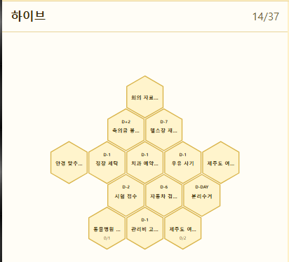 | 14칸이 생겼다. 칸이 작아 제목이 잘린다 → [이슈 #4](https://github.com/eple-lab/task-hive/issues/4). D-day 표시와 하위 태스크 진행(0/1, 0/2)이 보인다 |

"MD로 내려받기" 결과: [hive-export.md](hive-export.md)

- 14개가 그대로 내려받아졌고, 하위 태스크(사료 주문, 비행기표, 렌터카)도 들여쓰기로 나온다.
- 날짜 틀린 것이 그대로 보인다: 헬스장 재등록 11-25(맞는 것 11-20), 자동차 검사 11-24(11-23), 축의금 봉투 11-16(지난 날짜, D+2).
