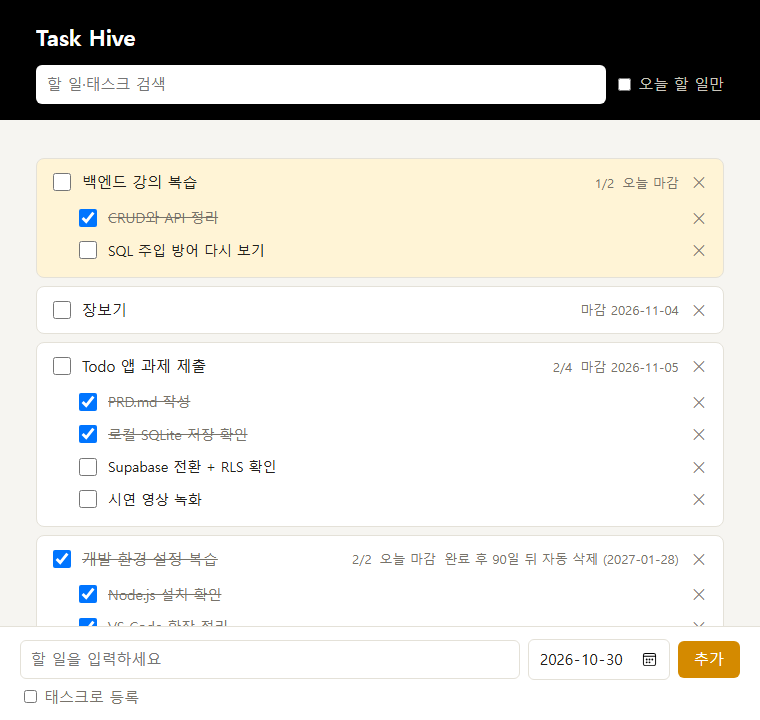
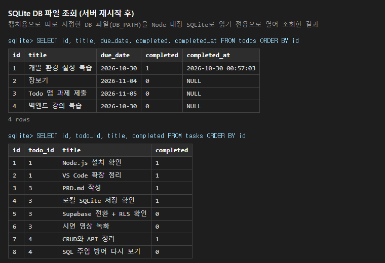

# 저장·보안 확인 기록

과제 평가 기준 "로컬과 Supabase에서 각각 데이터 저장을 확인한 결과와 클라우드 전환·RLS 확인 기록"을 위한 문서.

## 한 줄 요약

| 항목 | 결과 |
|---|---|
| 길 A - 로컬 SQLite 저장 | ✅ 서버를 껐다 켜도 할 일·태스크가 그대로 남음 (2026-10-30) |
| 길 B - 클라우드 전환 | ✅ 코드 전환 완료: 저장소 SQLite → Supabase, 로그인 추가 (커밋 B-1~B-4) |
| 길 B - RLS 정책 | ✅ 메모리 Postgres에서 두 사용자로 검증 ([testing.md](testing.md#supabase-스키마rls-테스트-기록-길-b)) |
| 길 B - Supabase 실제 저장 | ⏳ 실제 프로젝트 연결 후 기록 |
| 길 B - 실제 계정 두 개 RLS | ⏳ 실제 프로젝트 연결 후 기록 |

## 길 B - Supabase

> 실제 Supabase 프로젝트를 연결한 뒤 채운다. 순서는 [supabase-setup.md](supabase-setup.md).

### 1. 저장 확인
- [ ] 할 일 추가 → Table Editor의 `todos`에 행, `user_id` 채워짐
- [ ] 서버 재시작 후에도 그대로

### 2. RLS 확인
- [ ] 계정 B에서 계정 A의 할 일이 안 보임
- [ ] `npm run check:rls` 결과

## 길 A - 로컬 SQLite

- 코드 버전: `path-a` 태그 (`git checkout path-a`로 이 상태를 다시 볼 수 있다)
- 방법: 캡처용 DB 파일을 지정해 서버 실행(`DB_PATH`) → 할 일 4개·태스크 8개 등록 → 화면 캡처 → 서버 종료 → 같은 DB 파일로 서버 다시 실행 → 화면 캡처 → DB 파일을 직접 조회

### 1. 등록 직후

### 2. 서버를 껐다 다시 켠 뒤

### 3. DB 파일 직접 조회
화면이 아니라 DB 파일에 실제로 행이 저장됐는지 확인했다.

- `todos` 4행, `tasks` 8행
- 완료한 할 일은 `completed = 1`과 `completed_at`이 함께 기록됨
- 태스크의 `todo_id`가 각 할 일의 `id`를 가리킴 (1:N)

### 삭제·완료 동작
삭제·완료와 규칙 검사 결과는 [testing.md](testing.md)의 API·화면 테스트 기록.
